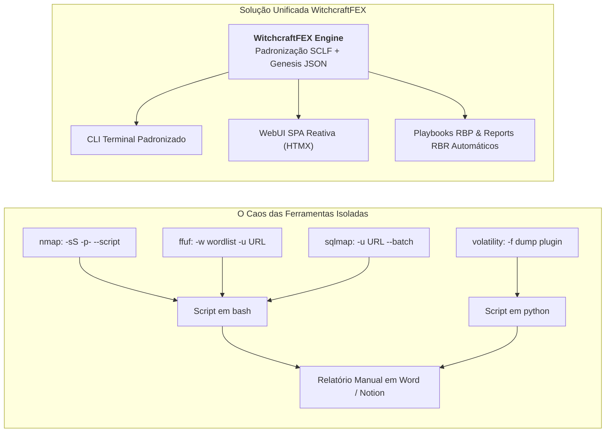
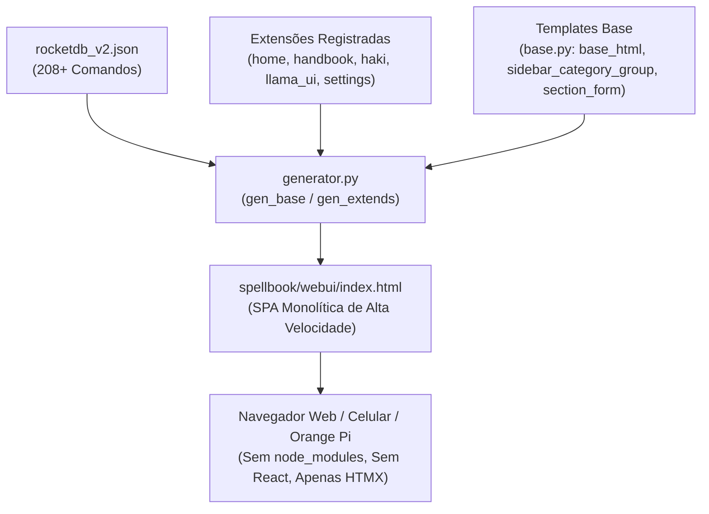

# ⛩️ CYPHERPUNK: O Grimório do Netrunner & A Unificação Purple Team
> *Apresentação Técnica, Arquitetural e Operacional do Framework WitchcraftFEX*  
> **Autor do Framework & Wiki:** COSMIC ZIP  
> **Tema & Filosofia:** Cypherpunk / Netrunning Culture / Unificação Ofensiva e Defensiva  
> **Referência Wiki:** [The Netrunner Guide](https://cosmic-zip.github.io/) | [Netrunning Section](https://cosmic-zip.github.io/?page=%E2%98%A3%EF%B8%8F_netrunning)

---

```
░░░░░░░░░░░░░░░░░░░░░░░░░░░░░░░░░░░░░░░░░░░░░░░░░░░░░░░░░░░░░░░░░░░░░░░░░░░░░░░░░░░░░░░░░░░░░░░░░░░░░░░░░░░░░░░░░░░░░░░░░░░░░░░░
                                   WitchcraftFEX v0.1.0 by COSMIC ZIP
░░░░░░░░░░░░░░░░░░░░░░░░░░░░░░░░░░░░░░░░░░░░░░░░░░░░░░░░░░░░░░░░░░░░░░░░░░░░░░░░░░░░░░░░░░░░░░░░░░░░░░░░░░░░░░░░░░░░░░░░░░░░░░░░
                 ███╗   ██╗███████╗████████╗████████╗██████╗  █████╗ ██╗   ██╗███████╗██╗     ███████╗██████╗ 
                 ████╗  ██║██╔════╝╚══██╔══╝╚══██╔══╝██╔══██╗██╔══██╗██║   ██║██╔════╝██║     ██╔════╝██╔══██╗
                 ██╔██╗ ██║█████╗     ██║      ██║   ██████╔╝███████║██║   ██║█████╗  ██║     █████╗  ██████╔╝
                 ██║╚██╗██║██╔══╝     ██║      ██║   ██╔══██╗██╔══██║╚██╗ ██╔╝██╔══╝  ██║     ██╔══╝  ██╔══██╗
                 ██║ ╚████║███████╗   ██║      ██║   ██║  ██║██║  ██║ ╚████╔╝ ███████╗███████╗███████╗██║  ██║
                 ╚═╝  ╚═══╝╚══════╝   ╚═╝      ╚═╝   ╚═╝  ╚═╝╚═╝  ╚═╝  ╚═══╝  ╚══════╝╚══════╝╚══════╝╚═╝  ╚═╝           
                                             ,----------------,              ,---------,
                                        ,-----------------------,          ,"        ,"|
                                      ,"                      ,"|        ,"        ,"  |
                                     +-----------------------+  |      ,"        ,"    |
                                     |  .-----------------.  |  |     +---------+      |
                                     |  |                 |  |  |     | -==----'|      |
                                     |  |  COME TO THE    |  |  |     |         |      |
                                     |  |  PURPLE SIDE    |  |  |/----|`---=    |      |
                                     |  |  $ wfex.py     |  |  |   ,/|==== ooo |      ;
                                     |  |                 |  |  |  // |(((( [33]|    ,"
                                     |  `-----------------'  |," .;'| |((((     |  ,"
                                     +-----------------------+  ;;  | |         |,"     
                                        /_)______________(_/  //'   | +---------+
                                   ___________________________/___  `,
                                  /  oooooooooooooooo  .o.  oooo /,   \,"-----------
                                 / ==ooooooooooooooo==.o.  ooo= //   ,`\--{)B     ,"
                                /_==__==========__==_ooo__ooo=_/'   /___________,"
                                `-----------------------------' 
░░░░░░░░░░░░░░░░░░░░░░░░░░░░░░░░░░░░░░░░░░░░░░░░░░░░░░░░░░░░░░░░░░░░░░░░░░░░░░░░░░░░░░░░░░░░░░░░░░░░░░░░░░░░░░░░░░░░░░░░░░░░░░░░
```

---

## 📑 MAPA DE NAVEGAÇÃO DA APRESENTAÇÃO

| Módulo | Tema Estratégico | Tópicos Centrais e Abordagem |
| :--- | :--- | :--- |
| **[Módulo 01](#módulo-01-o-manifesto-cypherpunk--o-universo-hacker)** | **O Manifesto Cypherpunk & O Universo Hacker** | Raízes históricas, privacidade como autodefesa, taxonomia de atores no ciberespaço e as 5 camadas de sobrevivência do Netrunner. |
| **[Módulo 02](#módulo-02-o-problema-da-fragmentação-de-ferramentas-tool-fatigue)** | **Fragmentação de Ferramentas & "Tool Fatigue"** | O caos de ecossistemas isolados, sobrecarga cognitiva do analista e a resposta arquitetural através do padrão SCLF e zero-deps. |
| **[Módulo 03](#módulo-03-ciclos-red-blue-e-purple-team--a-automação-contínua)** | **Ciclos Red, Blue e Purple Team** | Alinhamento operacional contínuo, eliminação de silos corporativos, playbooks RBP e relatórios auditáveis RBR. |
| **[Módulo 04](#módulo-04-mapeamento-de-capacidades-do-framework-por-domínio-de-segurança)** | **Capacidades Técnicas por Domínio** | Arsenal ofensivo Web/AD, análise de tráfego e espectro wireless, engenharia forense DFIR, anti-forensics e matriz de risco OWASP. |
| **[Módulo 05](#módulo-05-o-spellbook--o-grimório-cyberpunk-inspirado-na-missão-do-nix)** | **O Spellbook: O Grimório Cyberpunk** | O conceito mítico de Nix (Cyberpunk 2077), daemons nativos, suíte de criptografia, payloads de engenharia social e IA offline. |
| **[Módulo 06](#módulo-06-engenharia--arquitetura-de-software-a-geração-procedural)** | **Arquitetura de Software e Geração Procedural** | O catálogo SSoT em `rocketdb_v2.json`, compilador CLI em super-strings, compilação de SPA em HTMX, servidor em Go e telemetria. |
| **[Módulo 07](#módulo-07-cheat-sheet-rápido-de-comandos--casos-de-uso-reais)** | **Cheat-Sheet Operacional & Casos Reais** | Comandos canônicos de terminal prontos para demonstração em tempo real de reconhecimento, exploração, DFIR e auditoria. |
| **[Módulo 08](#módulo-08-conclusão--roteiro-de-escolha-de-slides-para-apresentação)** | **Conclusão & Matriz de Escolha de Slides** | Guia de adaptação da apresentação conforme a audiência: cultura hacker, engenharia de software, especialistas ou executivos de TI. |

---

# Módulo 01: O Manifesto Cypherpunk & O Universo Hacker

### 1.1. As Raízes do Movimento Cypherpunk

O movimento Cypherpunk floresceu no final dos anos 1980 e ganhou formalização canônica na década de 1990 pelas mãos de Eric Hughes, Timothy C. May e John Gilmore através do emblemático *Cypherpunk Manifesto*. O documento estabeleceu um compromisso inegociável entre a matemática pura e os direitos civis na alvorada do ciberespaço.

> *"Privacidade é necessária para uma sociedade aberta na era eletrônica... Nós, os Cypherpunks, somos dedicados a construir sistemas anônimos. Defendemos nossa privacidade com criptografia, com sistemas de encaminhamento de correio anônimo, com assinaturas digitais e dinheiro eletrônico."*

A essência dessa visão fundamenta que a privacidade real jamais pode ser concedida por governos benevolentes ou corporações vigilantes. Ela precisa ser forjada ativamente com código aberto, algoritmos criptográficos robustos e soberania computacional intransigente.

Sob essa ótica, a criptografia deixa de ser uma mera disciplina teórica de segurança da informação e assume o papel de escudo e arma de autodeterminação. Quando um sistema depende de caixas-pretas proprietárias ou de servidores alheios, o usuário deixa de ter soberania e converte-se em alvo de telemetria indesejada ou vigilância estatal.

### 1.2. Taxonomia dos Agentes no Ciberespaço (Tipos de Hackers)

Na cultura contemporânea de segurança ofensiva e defensiva, os atores operam a partir de incentivos, éticas e metodologias distintas:

| Categoria | Motivação Primária | Alvos Típicos | Postura Ética e Jurídica |
| :--- | :--- | :--- | :--- |
| **White Hat (Pesquisador Ético)** | Defesa, mitigação preventiva, conformidade e reporte responsável | Infraestruturas com escopo formal e programas de Bug Bounty | Plenamente legal, subordinada a contratos e termos de autorização |
| **Black Hat (Cibercriminoso)** | Lucro financeiro, extorsão via ransomware, espionagem e sabotagem | Qualquer infraestrutura com dados valiosos ou vulnerabilidades críticas | Ilícita, predatória, voltada para dano, disrupção ou monetização |
| **Grey Hat (Pesquisador Independente)** | Curiosidade técnica, notoriedade intelectual e exposição pública | Sistemas corporativos e governamentais expostos na Internet | Limítrofe: invade sem anuência prévia, embora reporte ou torne pública a falha |
| **Hacktivista** | Defesa ideológica, combate à censura e denúncia de abusos de poder | Órgãos estatais corruptos, conglomerados abusivos e alvos de repressão | Ações de desobediência civil cibernética, como vazamentos de documentos e defacements |
| **State-Sponsored (APTs)** | Superioridade geopolítica, ciberespionagem militar e sabotagem física | Defesa nacional, telecomunicações, energia e instalações industriais críticas | Recursos financeiros virtualmente ilimitados, furtividade extrema e persistência prolongada |
| **Script Kiddie vs. Netrunner** | Reconhecimento social superficial vs. Maestria matemática profunda | Alvos arbitrários fáceis vs. Sistemas complexos de alta segurança | O Script Kiddie reproduz automações sem discernimento; o Netrunner domina o fluxo elementar dos bytes |

### 1.3. O Ethos do Netrunner Conforme a Wiki Cosmic

Conforme estabelecido formalmente na seção de netrunning da Wiki do Cosmic, o Netrunner contemporâneo rejeita a postura passiva de mero operador de ferramentas pré-moldadas. Seu modus operandi é impulsionado por curiosidade analítica, compreensão de baixo nível dos protocolos de rede e capacidade cirúrgica de decompor regras computacionais.

#### Camada Psicológica e Disciplina de OPSEC
A proteção primordial do operador inicia-se na gestão consciente de rastros operacionais. Isso exige o emprego de identidades digitais fragmentadas e compartmentalizadas (*Sock Puppets*), controle intransigente sobre metadados pessoais e manutenção de perfis neutros no ecossistema da rede.

#### Camada de Espaço de Usuário e Gestão Criptográfica Local
O armazenamento de segredos é mantido estritamente sob posse local em cofres seguros como KeePassXC ou instâncias offline de Bitwarden. A navegação em superfícies hostis dispensa navegadores comerciais repletos de telemetria invasiva, privilegiando opções enrijecidas como LibreWolf, Ladybird e compilações customizadas de Firefox com isolamento rigoroso de cookies, complementados por volumes cifrados com VeraCrypt.

#### Camada de Rede e Roteamento Descentralizado
O tráfego de dados é submetido a redes anônimas resilientes como Tor, I2P e Freenet. Requisições maliciosas e rastreadores de telemetria corporativa são neutralizados na origem mediante sumidouros locais de DNS como Pi-hole e listas sintéticas em `/etc/hosts`, além de isolamento granular via NetGuard e UFW.

#### Camada de Sistema Operacional e Virtualização Compartimentalizada
A execução de tarefas críticas ocorre em ambientes hipervisores com isolamento de domínio no estilo Qubes OS, onde controladores de rede operam confinados em uma NetVM dedicada sem acesso aos núcleos de trabalho. Sistemas voláteis e amnésicos como Tails e distribuições minimalistas garantem que nenhum estado persistente permaneça após a desconexão.

#### Camada de Hardware e Mitigação Física
O operador mantém salvaguardas ativas contra vetores físicos de intrusão, mitigando ataques de inicialização a frio (*Cold-Boot*), leitura de barramento DMA via portas Thunderbolt ou PCIe desprotegidas, e invasões do tipo *Evil-Maid*. Chaves mestras de criptografia repousam exclusivamente em discos com suporte a *Self-Encrypting Devices* (SED) associados a hardware de segurança autônomo.

---

# Módulo 02: O Problema da Fragmentação de Ferramentas ("Tool Fatigue")

### 2.1. O Cenário Caótico da Cibersegurança Atual

O cotidiano de operadores de segurança, analistas de resposta a incidentes e especialistas em testes de intrusão é marcado por uma proliferação desordenada de programas. Cada nicho da segurança exige um conjunto particular de utilitários isolados, transformando a rotina técnica em uma sobrecarga operacional exaustiva.

#### Reconhecimento Perimetral e Escaneamento de Superfície
Para mapear hosts, serviços ativos e topologia de rede, o profissional tradicionalmente recorre a ferramentas como `nmap`, `rustscan`, `sublist3r`, `amass`, `netcat`, `ping`, `traceroute` e `whois`, enfrentando discrepâncias severas nas formas como alvos e máscaras de rede são aceitos em linha de comando.

#### Auditoria Web e Varredura de APIs Modernas
A identificação de vulnerabilidades em serviços HTTP requer a orquestração manual de utilitários como `curl`, `ffuf`, `katana`, `arjun`, `sqlmap`, `nikto`, `wpscan` e `jwt-tool`, gerando volumes caóticos de saídas textuais que precisam ser reconciliados às pressas.

#### Análise de Tráfego de Rede e Espectro Wireless
A inspeção profunda de pacotes e auditoria de redes sem fio depende de binários como `tcpdump`, `tshark`, `wireshark`, `aircrack-ng`, `bettercap`, `macchanger` e `arpspoof`, exigindo controle manual contínuo sobre placas de rede e modos promiscuos.

#### Testes de Intrusão Interna e Active Directory
A exploração de ecossistemas corporativos baseados em Windows demanda o arsenal da suíte `impacket` com dezenas de scripts Python específicos, `crackmapexec`, `kerbrute` e coletores gráficos como `bloodhound`, cada qual operando com formatos idiossincráticos de autenticação.

#### Computação Forense, DFIR e Engenharia Reversa
A análise pós-incidente e a extração de evidências impõem o manuseio de ferramentas especializadas como `volatility`, `yara`, `foremost`, `binwalk`, `exiftool`, `xxd` e `lsof`, operando sobre dumps binários brutos e estruturas de memória proprietárias.

#### Infraestrutura de Tunelamento e Controle de C2
O estabelecimento de comunicações seguras para pivoting e persistência envolve `chisel`, `socat`, `ssh`, `openvpn` e `wireguard`, demandando remapeamento manual de portas e criação de regras de roteamento efêmeras.

### 2.2. A Sobrecarga Cognitiva e Falhas Operacionais Decorrentes

#### Incompatibilidade Sintática e Atrito Semântico
A ausência de convenção unificada entre utilitários gera atrito constante. Um programa exige `-u` para designar uma URL, enquanto o próximo requer `--url` e outro aceita o endereço apenas como parâmetro posicional. As flags de portas sofrem do mesmo desvio, oscilando imprevisivelmente entre `-p`, `-P`, `--port` ou sequências delimitadas por hífen ou vírgula.

#### Fragmentação de Runtimes e o Caos de Dependências
A coexistência forçada de bibliotecas legadas de Python 2 com runtimes modernos de Python 3, versões conflitantes de OpenSSL, ferramentas em Go, utilitários compilados em Rust e módulos de Ruby culmina frequentemente em quebras de ambiente no meio de auditorias decisivas.

#### Disparidade de Formatos e Fragilidade de Saída
A ausência de estruturação consistente gera saídas heterogêneas compostas por texto puro desordenado, JSON malformado, XML prolixo e tabelas com caracteres truncados. Para encadear o diagnóstico de um escaneador à carga útil de um exploit, o analista se vê forçado a redigir *glue scripts* temporários e propensos a falhas.

#### Perda de Foco Crítico e Diluição Operacional
A dispersão mental gerada pela necessidade contínua de pesquisar sintaxes esquecidas no histórico do shell (`Ctrl+R`) ou ler documentações confusas degrada a capacidade analítica da equipe, reduzindo a agilidade de resposta frente a incidentes cibernéticos reais.



### 2.3. A Resposta Arquitetural do WitchcraftFEX: Abstração e Serialização

O WitchcraftFEX adota a filosofia clássica dos *Coreutils* UNIX combinada com autonomia técnica absoluta. O framework não instala nem requer bibliotecas externas em Python, apoiando-se unicamente nos módulos nativos da linguagem e em binários do sistema operacional hospedeiro, garantindo portabilidade integral em qualquer ambiente Linux.

Todos os comandos do ecossistema são declarados como super-strings universais parametrizadas por pontos de injeção dinâmicos no padrão `@@keyword`. Esse desenho permite encapsular rotinas sofisticadas de múltiplos passos sob um vocabulário declarativo claro.

A interação com o arsenal é harmonizada pelas *Standard Command-Line Flags* (SCLF). Nomes de argumentos essenciais são padronizados uniformemente em parâmetros previsíveis como `--target`, `--interface`, `--file`, `--port` e `--command`, dispensando a necessidade de reaprender sintaxes arbitrárias para cada ferramenta individual.

---

# Módulo 03: Ciclos Red, Blue e Purple Team – A Automação Contínua

### 3.1. Definição Estratégica dos Times

```
                ┌──────────────────────────────────────┐
                │          PURPLE TEAM LOOP            │
                │     "Melhoria Contínua & Sinergia"   │
                └──────────────────┬───────────────────┘
                                   │
         ┌─────────────────────────┴─────────────────────────┐
         ▼                                                   ▼
┌─────────────────────────────────┐         ┌─────────────────────────────────┐
│            RED TEAM             │         │            BLUE TEAM            │
│  [Reconhecimento & OSINT]       │         │  [Monitoramento em Tempo Real]  │
│  [Engenharia Social / Phishing] │ ◄─────► │  [Detecção de Intrusões & SIEM] │
│  [Fuzzing & Exploração]         │ feedback│  [DFIR & Forense de Memória]    │
│  [Movimentação Lateral & AD]    │ contínuo│  [Resposta a Incidentes (IR)]   │
│  [C2, Ransomware Demo, Pivoting]│         │  [Regras YARA & Threat Hunting] │
└─────────────────────────────────┘         └─────────────────────────────────┘
```

#### Red Team: Simulação Adversarial Orientada ao MITRE ATT&CK
O time vermelho assume a postura metodológica de agentes de ameaça concretos, emulando táticas, técnicas e procedimentos catalogados para desafiar as barreiras da organização. Seu objetivo prioritário consiste em identificar caminhos de penetração perimetral, obter escalada de privilégios de sistema, executar movimentação lateral e instituir persistência velada.

#### Blue Team: Resiliência Defensiva e Engenharia de Detecção
O time azul mantém a custódia da integridade operacional do ambiente, analisando continuamente telemetrias de tráfego, chamadas de sistema e artefatos de memória volátil. Sua responsabilidade engloba a calibração de regras em sistemas SIEM e EDR, a detecção tempestiva de anomalias e a execução rigorosa de rotinas de resposta a incidentes.

#### Purple Team: Sinergia Operacional e Eliminação de Silos
A prática de Purple Team rompe com o isolamento histórico entre agressores simulados e analistas de defesa. Em vez de exercícios opacos de ponta a ponta sem comunicação, o ciclo opera através de testes calibrados em tempo real, onde cada investida ofensiva é acompanhada pela verificação imediata dos sensores defensivos, otimizando investimentos e acelerando a remediação de lacunas.

### 3.2. Como o WitchcraftFEX Orquestra o Ciclo Purple Team

#### Fase 1: Estímulo Ofensivo Padronizado (Red Action)
O operador deflagra estímulos adversariais determinísticos diretamente pela CLI ou interface do WitchcraftFEX. Os exercícios abrangem desde a emulação controlada de impacto via `pkg/blood_moon`, passando por enumeração refinada de identidades no Active Directory com `kerbrute.userenum`, até manipulação ativa de protocolos de enlace por `arpspoof.poison`.

#### Fase 2: Validação Defensiva e Forense Imediata (Blue Verification)
Sem abandonar o mesmo ambiente integrado, a equipe defensiva inspeciona instantaneamente os reflexos gerados pelo teste. O operador audita acessos anômalos por meio de `view.authlog`, executa buscas heurísticas por artefatos com `yara.scan_dir` e investiga a presença de processos desvinculados em memória executando `volatility.pslist`.

#### Fase 3: Automação Contínua de Playbooks (RBP - Rule-Based Playbooks)
O framework permite consolidar rotinas mistas de ataque e verificação em playbooks reutilizáveis e automatizados. Esse mecanismo confere previsibilidade aos testes periódicos de regressão, assegurando que o perímetro corporativo mantenha sua integridade após cada ciclo de correções ou atualizações de regras.

#### Fase 4: Consolidação e Relatórios Estruturados (RBR - Rule-Based Reports)
As evidências reunidas ao longo dos testes são convertidas proceduralmente em relatórios alinhados aos padrões internacionais da OWASP e dotados de métricas objetivas de risco com notas de 0 a 10. Esse fluxo simplifica a transição de conclusões estritamente técnicas para documentos executivos destinados a gestores e auditorias corporativas.

---

# Módulo 04: Mapeamento de Capacidades do Framework por Domínio de Segurança

O catálogo `rocketdb_v2.json` organiza de maneira declarativa mais de 200 ferramentas e rotinas pré-configuradas. A estrutura abaixo detalha a distribuição das capacidades do framework pelos principais domínios de segurança da informação:

### 4.1. Ferramental Ofensivo (Web, Active Directory, Exploração, Tunnels & Shells)

#### Web Fuzzing, Rastreamento e Descoberta de Superfície de Ataque
A análise de serviços Web é coberta por rotinas de alto desempenho. O comando `ffuf.fuzz` acelera a descoberta de arquivos e diretórios protegidos a partir de wordlists nativas do ecossistema. O rastreador `katana.crawl` analisa profundamente rotas e bibliotecas JavaScript modernas para expor endpoints ocultos. O identificador `arjun.params` mapeia parâmetros vulneráveis em requisições GET, POST e JSON, enquanto `sqlmap.scan` automatiza a exploração de injeções SQL e a extração estruturada de bancos de dados.

#### Auditoria de Active Directory e Infraestrutura Windows
Para ambientes Windows empresariais, o framework integra recursos avançados de avaliação de credenciais e movimentação lateral. Os utilitários `impacket.psexec` e `impacket.wmiexec` viabilizam a interação administrativa legítima sem exigir a instalação de artefatos adicionais. O extrator `impacket.secretsdump` obtém com segurança hashes de controladores de domínio (NTDS.dit, SAM e LSA). Simultaneamente, `crackmapexec.smb` e `crackmapexec.winrm` realizam pulverização controlada de senhas (*password spraying*), enquanto `kerbrute.userenum` valida usuários via pré-autenticação Kerberos sem acionar mecanismos de bloqueio de contas.

#### Criptoanálise e Quebra Acelerada de Hashes
A suíte incorpora motores de força bruta e análise criptográfica para avaliar a robustez de credenciais corporativas. Os comandos `hashcat.ntlm` e `hashcat.md5` aproveitam a aceleração por GPU para recuperar hashes complexos. A ferramenta `john.crack` aplica regras semânticas personalizadas sobre wordlists temáticas, enquanto os módulos `jwt.inspect` e `jwt.crack` diagnosticam falhas de configuração em tokens JWT, identificando chaves fracas ou algoritmos permissivos como `none`.

#### Pivoting de Rede, Tunelamento Criptografado e Sessões Interativas
Para progressão lateral e bypass de inspeção perimetral, o framework implementa rotinas como `chisel.server` e `chisel.client`, estabelecendo túneis reversos TCP/UDP criptografados sob tráfego HTTP e WebSockets legítimos. O manipulador `socat.redirect` encaminha fluxos de controle e portas de comando, enquanto `nc.listen` e `nc.reverse` fornecem sessões interativas e handlers universais para operadores de campo.

### 4.2. Análise de Rede, Wireless & MITM

#### Inspeção de Baixo Nível e Captura de Pacotes
A telemetria detalhada de rede é conduzida por rotinas que automatizam o `tcpdump`. O utilitário `capture.all` armazena o tráfego de interfaces específicas em arquivos PCAP com marcações temporais no padrão `capture_wlan0_28-10-25_00_15_00.pcap`. Rotinas complementares como `capture.host` e `capture.port` aplicam filtros seletivos na origem, enquanto `tshark.extract_http` disseca arquivos de captura para extrair cabeçalhos HTTP, rotas sensíveis e credenciais transmitidas em claro.

#### Manipulação de Camada de Enlace e Evasão de Filtros
Para auditoria de controle de acesso físico e testes de personificação, `mac.spoof` realiza a alternância pseudorrandômica do endereço MAC via `macchanger`. Paralelamente, `arpspoof.poison` executa envenenamento bidirecional da tabela ARP em redes locais comutada, posicionando o operador como interceptador Man-In-The-Middle para fins de avaliação de segurança.

#### Auditoria de Espectro Wireless e Dispositivos Bluetooth
A avaliação de redes sem fio apoia-se em `aircrack.listen` para monitoramento passivo de quadros 802.11 e captura de *4-way handshakes*, complementado por `aircrack.crack` para validação da robustez de chaves WPA2 e WPA3. No âmbito de conexões de curto alcance, `blue.enable` e `blue.list` coordenam o stack Bluetooth do sistema operacional para auditar dispositivos periféricos expostos.

#### Reconhecimento Perimetral e Inteligência de Ameaças em Tempo Real
A identificação de ativos e reputação de rede reúne `scan.nmapper` para acionamento de scripts NSE categorizados, o motor `native.scanner.ip` para consulta offline de pontuações de risco baseadas nas bases IP2Proxy LITE e cinsscore, e o rastreador `native.scanner.netcrawler.ipv4` para mapeamento geográfico e analítico de blocos CIDR.

### 4.3. Computação Forense (DFIR) & Anti-Forense

#### Análise Forense de Memória Volátil
A detecção de intrusões sofisticadas em sistemas Windows é realizada por `volatility.pslist`. A rotina inspeciona dumps físicos de memória RAM para expor malwares e processos ocultos mediante manipulação direta de objetos do kernel (*DKOM - Direct Kernel Object Manipulation*), identificando anomalias invisíveis aos gerenciadores convencionais do sistema.

#### Carving de Artefatos em Disco e Desconstrução de Firmwares IoT
A recuperação de dados deletados ou danificados em mídias brutas (`.dd` ou `.raw`) é executada por `foremost.carve`, reconstruindo estruturas de arquivos via análise de cabeçalhos e rodapés característicos (*magic bytes*) de imagens, documentos e binários. Para dispositivos conectados e IoT, `binwalk.extract` decompõe recursivamente imagens de firmware, extraindo sistemas de arquivos embarcados como SquashFS e CramFS em busca de certificados embutidos e credenciais fixas.

#### Threat Hunting e Varredura Heurística via Assinaturas YARA
A busca ativa por vestígios de comprometimento em servidores é liderada por `yara.scan_dir`. A função executa varreduras profundas em diretórios críticos do sistema (`/`, `/tmp`, `/var/www`) cruzando regras de detecção de webshells, scripts ofuscados e malwares conhecidos.

#### Auditoria de Logs do Sistema Operacional e Eventos de Kernel
A reconstrução histórica de incidentes em ambientes GNU/Linux é viabilizada por módulos dedicados. O comando `view.authlog` isola os registros recentes de tentativas de autenticação e elevações por `sudo`. Os utilitários `view.btmp` e `view.wtmp` detalham tentativas frustradas de login em massa e conexões ativas no sistema, enquanto `view.auditlog` examina eventos profundos reportados pelo subsistema de auditoria do kernel.

#### Técnicas Anti-Forenses e Higienização Irreversível de Mídias
Para assegurar que operações autorizadas não vazem dados confidenciais após a conclusão de auditorias, `file.clean.meta` emprega o `exiftool` para depurar metadados proprietários em documentos e imagens antes de qualquer movimentação. Para eliminação irreversível de artefatos residuais, `clean.shred` e `clean.wipe` aplicam até 10 passos sucessivos de sobrescrita criptográfica aleatória com finalização em zeros (`shred -u -z -n 10`), inviabilizando qualquer recuperação física posterior.

### 4.4. Documentação, Playbooks (RBP) e Relatórios OWASP (RBR)

O módulo de geração de relatórios (`gen.report` e `cosmic.report`) consolida automaticamente os resultados obtidos ao longo das etapas ofensivas e defensivas, gravando os artefatos no diretório `spellbook/reports/`. O catálogo de vulnerabilidades adota uma taxonomia formal com suporte nativo aos idiomas Português (`br`) e Inglês (`en`), permitindo contextualizar instantaneamente falhas estruturais como Injeção de Código, Falhas no Controle de Acesso e SSRF.

A gradação de severidade das anomalias segue uma escala objetiva padronizada para orientar as lideranças corporativas na priorização das correções:

| Nível de Risco | Pontuação | Impacto Operacional no Negócio | Exemplos Típicos de Vetores |
| :--- | :--- | :--- | :--- |
| **Crítico** | 10 | Comprometimento irrestrito da infraestrutura e perda total de controle | Execução remota de código (RCE) não autenticada e vazamento integral de banco de dados |
| **Alto** | 7 a 9 | Ruptura grave de autenticação e obtenção de privilégios executivos | Bypass estrutural de login, escalada de privilégio local e requisições SSRF em redes internas |
| **Médio** | 4 a 6 | Exposição condicionada de dados ou necessidade de ação da vítima | CSRF em ações financeiras, XSS refletido com desvio de sanitização e vazamento de informações |
| **Baixo** | 1 a 3 | Desvios leves de boas práticas e superfícies informacionais menores | Atributos frouxos em cookies de sessão e ausência de cabeçalhos de segurança (HSTS, CSP) |
| **Negligenciável** | 0 | Oportunidades pontuais de endurecimento da infraestrutura | Exibição de versões de software em banners de boas-vindas e pequenos refinamentos de arquitetura |

---

# Módulo 05: O Spellbook – O Grimório Cyberpunk Inspirado na Missão do Nix

### 5.1. A Referência Canônica: Cyberpunk 2077 & Nix

No cenário distópico de *Cyberpunk 2077*, nas instalações lendárias do clube *Afterlife*, o experiente netrunner **Nix** incumbe o protagonista das missões *"KOLD MIRAGE"* e *"SPELLBOUND"*. A narrativa gira em torno da recuperação de um **Spellbook (Grimório)** ancestral, remanescente dos tempos que antecederam o cataclismo do *DataKrash*. Essa compilação reúne daemons proibidos e algoritmos concebidos por **Rache Bartmoss**, o icônico transgressor que provocou a ruína da Velha Rede.

No imaginário cyberpunks, um grimório não se confunde com fantasia esotérica: trata-se de uma compilação de código de elite meticulosamente projetada para ultrapassar barreiras ICE (*Intrusion Countermeasure Electronics*) implacáveis e preservar operacionalidade mesmo em ambientes hostis isolados além do *Blackwall*.

```
                  ┌─────────────────────────────────────┐
                  │    SPELLBOOK / GRIMOIRE DIRECTORY   │
                  │   O Deck Portátil do Netrunner      │
                  └──────────────────┬──────────────────┘
                                     │
    ┌──────────────┬─────────────────┼─────────────────┬──────────────┐
    ▼              ▼                 ▼                 ▼              ▼
┌────────┐    ┌─────────┐      ┌───────────┐     ┌───────────┐  ┌───────────┐
│  pkg/  │    │database/│      │wordlists/ │     │evilpages/ │  │  models/  │
│Binários│    │Genesis  │      │Dicionários│     │Phishing & │  │Yuri AI    │
│Nativos │    │RocketDB │      │Payloads   │     │Engenharia │  │DeepSeek   │
│Autônomos│   │v1 & v2  │      │Fuzzing    │     │Social     │  │Offline    │
└────────┘    └─────────┘      └───────────┘     └───────────┘  └───────────┘
```

### 5.2. A Anatomia Estrutural do Spellbook no WitchcraftFEX

O diretório `spellbook/` do WitchcraftFEX foi concebido e estruturado como uma homenagem direta a esse princípio, assumindo a função do cyberdeck portátil e autossuficiente do analista.

#### Pacotes Standalone e Daemons Nativos (spellbook/pkg/)
Essa seção reúne binários autônomos que dispensam a presença de pacotes de terceiros no sistema anfitrião. Destaca-se o `blood_moon`, um simulador compacto de ransomware empregado em testes de resiliência e validação de rotinas de recuperação de dados. O clássico `busybox` disponibiliza um ecossistema completo de utilitários POSIX em compilação estática. A suíte `enigmata` atua no isolamento e na proteção criptográfica de cargas úteis durante o tráfego.

O runtime `llama` fornece o suporte computacional para inferências de modelos de linguagem diretamente no terminal do operador. O módulo `maidzero` gerencia a integridade do host e efetua rotinas de limpeza e proteção anti-forense. O serviço `server` disponibiliza um servidor web estático e veloz compilado em Go, livre de dependências de interpretadores externos. A plataforma inclui ainda o `simple_ctf` para treinamento e exercícios práticos de segurança, o gerenciador estendido de pacotes `lamx` para manutenção do sistema operacional, e o utilitário `update_hosts` para controle do DNS local e contenção de telemetrias externas.

#### Dicionários e Bases de Fuzzing (spellbook/wordlists/ & spellbook/fuzzing/)
Reúne listas especializadas de termos para enumeração acelerada de rotas em APIs REST, detecção de arquivos sensíveis deixados em servidores Web, verificação de credenciais padrão empregadas em dispositivos IoT e dicionários de termos para injeção de parâmetros.

#### Vetores de Engenharia Social (spellbook/evilpages/)
Disponibiliza estruturas e templates de alta fidelidade visual para simulações controladas de campanhas de Phishing e conscientização corporativa sobre riscos de engenharia social interna.

#### Inteligência Artificial Soberana e Offline (spellbook/models/)
Abrigando a inteligência Yuri AI Engine, esse diretório contém modelos de linguagem quantizados em formatos compactos GGUF (Q4_K e Q6_M) do DeepSeek LLaMA 8B. O processamento ocorre exclusivamente na CPU ou GPU local da estação de trabalho, assegurando que nenhum dado confidencial, credencial ou relatório de auditoria seja transmitido para provedores externos de nuvem.

---

# Módulo 06: Engenharia & Arquitetura de Software: A Geração Procedural

A distinção arquitetural central do WitchcraftFEX repousa no seu paradigma declarativo. Nenhuma interface gráfica ou terminal é escrita de forma rígida ou artesanal: ambos os ambientes derivam proceduralmente de uma fonte única e canônica de dados.

### 6.1. O Arquivo Genesis: rocketdb_v2.json como Single Source of Truth

Toda a inteligência e os comandos reconhecidos pela plataforma estão mapeados no arquivo `rocketdb_v2.json`, em conformidade com o esquema JSON rigoroso:

```json
{
  "name": "scan.nmapper",
  "category": "security",
  "type": "shell",
  "description": "Perform comprehensive NMAP reconnaissance",
  "command": "nmap @@target -sV -sC --script=@@scripts",
  "extends": {},
  "arguments": {
    "target": {
      "description": "IPv4, IPv6 or target hostname"
    },
    "scripts": {
      "description": "Predefined Nmap script categories",
      "options": [
        "auth",
        "broadcast",
        "default",
        "discovery",
        "dos",
        "exploit",
        "vuln",
        "traveler"
      ]
    }
  }
}
```

O atributo `name` estabelece o identificador universal da rotina, empregado pelo despachante em chamadas como `main.py <name>`. O campo `command` armazena a super-string de execução, utilizando o prefixo `@@` para delimitar os pontos dinâmicos de substituição de variáveis. O parâmetro `category` determina o agrupamento temático da funcionalidade entre as categorias canônicas do sistema (`network`, `web`, `security`, `forensics`, `system`, `core`, `containers`, `firewall`, `database`, `antivirus`, `cleanup`). O bloco `arguments` especifica a lista de parâmetros aceitos, enquanto a seção `options` lista valores pré-configurados, permitindo que a interface WebUI instancie automaticamente caixas de seleção `<select>` e a CLI valide escolhas no manual do operador.

### 6.2. Motor CLI Procedural: Compilação de Super-Strings e SCLF

O núcleo do mecanismo de linha de comando encontra-se implementado em [metalcore/core.py](file:///home/cosmic/workspace/witchcraft-mono/witchcraft/metalcore/core.py), atuando como um despachante dinâmico e flexível:

```
[CLI User Input] ──> net_shell_router()
                           │
                           ├── Identifica flags globais (--output_mode_none, --output_mode_html)
                           ├── Trata comandos internos ('version', 'help', 'manual')
                           ├── Checa funções nativas registradas em FN_REGISTRY
                           └── net_parser()
                                     │
                                     ├── Carrega read_db() (rocketdb_v2.json)
                                     ├── Localiza o nó pelo "name"
                                     ├── Itera sobre argumentos:
                                     │     valor = search_arg(sys.argv, arg_name)
                                     │     cmd = cmd.replace(f"@@{arg_name}", valor)
                                     └── net_exec(cmd) ──> subprocess.Popen(shell=True)
                                                                 │
                                                                 └── net_logger() (ANSI / HTML / Raw)
```

#### Modos Polimórficos de Saída (net_logger)
O sistema adapta sua emissão de dados de acordo com o contexto operacional. O modo padrão `color` renderiza paletas cibernéticas em sequências ANSI no terminal. O formato `none` emite texto limpo em UTF-8 sem códigos de escape, simplificando o redirecionamento para filtros UNIX convencionais como `grep`, `awk` e `sed`. O modo `html` encapsula o fluxo de texto em tags estilizadas com CSS inline, possibilitando a incorporação imediata da saída da CLI em painéis Web através de requisições HTMX.

### 6.3. Motor WebUI Procedural: SPA Reativa com HTMX

O compilador web do framework, localizado em [interface/web/generator.py](file:///home/cosmic/workspace/witchcraft-mono/witchcraft/interface/web/generator.py), é acionado pelo comando `main.py build.web`:



#### Compilação Reativa de Formulários e Atributos HTMX
Ao iterar pelo arquivo JSON de ferramentas, o gerador constrói elementos `<section class="content-sec" id="UUID">` individuais. Parâmetros que contenham seleções finitas recebem formulários baseados em `<select>`, enquanto campos de entrada livre são renderizados como `<input type="text">`. Todas as seções são vinculadas aos atributos reativos do HTMX (`hx-get="http://localhost:5500"`, `hx-include="#FORM_INPUTS"`, `hx-target="#OUTPUT_DIV"`), eliminando a necessidade de frameworks volumosos em JavaScript no cliente.

#### Arquitetura de Navegação da Sidebar Colapsável
O layout organiza os mais de 200 comandos nas 11 categorias canônicas por meio de blocos recolhíveis acionados pela função nativa `toggleCategory('CAT_ID')`, garantindo usabilidade rápida mesmo em telas de dispositivos móveis ou sistemas embarcados.

#### Sistema de Extensões Modulares (mods_reg)
A interface acomoda extensões especializadas sem corromper o catálogo de comandos. A extensão `home` provê visualização contínua de telemetria de hardware e contêineres. O módulo `handbook` oferece um manual interativo com instruções detalhadas de pentest. A ferramenta `haki` adiciona uma barra flutuante de busca global inspirada em terminais. A extensão `llama_ui` fornece um canal de conversação com o assistente local Yuri IA, enquanto `settings` gerencia temas visuais, fundos de tela e tokens de autenticação.

### 6.4. Servidor Web Embarcado em Go & Telemetria em Tempo Real (nt_stats)

#### O Servidor Web Estático em Go e Validação Criptográfica
A entrega dos recursos estáticos e o atendimento às chamadas HTTP ocorrem por meio de um binário Go compilado de forma independente sem dependências dinâmicas de glibc. O servidor registra as conexões recebidas no arquivo `evil_server.log` com identificação temporal rigorosa. Como salvaguarda de segurança, o daemon confronta o host de origem com a variável de ambiente `NT_GEN_HOST` e exige a apresentação da assinatura digital `NT_COSMIC_SIGKEY`, bloqueando sumariamente comandos originados de nós desconhecidos.

#### Telemetria Contínua de Infraestrutura (nt_stats)
O sistema extrai métricas dinâmicas diretamente do sistema de arquivos `/proc`, do módulo `psutil`, de sockets locais do Docker e do barramento `virsh` (Libvirt KVM). As informações atualizam os mostradores gráficos da WebUI em tempo real, reportando o uso detalhado de processamento e memória, o inventário de contêineres e portas expostas, as máquinas virtuais em execução nos hipervisores e a relação de processos ativos do sistema.

---

# Módulo 07: Cheat-Sheet Rápido de Comandos & Casos de Uso Reais

Para demonstrações práticas durante apresentações técnicas ou rotinas reais de auditoria, o ecossistema disponibiliza chamadas padronizadas e previsíveis:

### 7.1. Comandos Essenciais do Sistema

As instruções abaixo permitem conferir a integridade da suíte, verificar a versão corrente, consultar a documentação interativa ou compilar novos artefatos procedurais:

```bash
# Exibir o banner Cypherpunk e verificar integridade operacional
main.py

# Exibir a versão corrente da plataforma
main.py version

# Acessar a documentação integral derivada do catálogo RocketDB
main.py manual

# Executar comando emitindo texto limpo para encadeamento em pipes
main.py map.local --output_mode_none > active_sockets.txt

# Reconstruir proceduralmente a SPA WebUI a partir do RocketDB
main.py build.web > spellbook/webui/index.html
```

### 7.2. Operações Ofensivas & Reconhecimento

O arsenal ofensivo opera através de comandos concisos para varreduras perimetrais, auditorias de aplicações Web, exploração de bancos de dados e pivoting interno:

```bash
# Executar varredura furtiva de portas via Nmap com perfil padrão
main.py scan.nmapper --target 192.168.1.100 --scripts default

# Realizar fuzzing em aplicação Web utilizando dicionário nativo do spellbook
main.py ffuf.fuzz --url http://alvo.local/FUZZ --wordlist spellbook/wordlists/common.txt

# Automatizar diagnóstico e extração via Injeção SQL
main.py sqlmap.scan --url "http://alvo.local/item.php?id=1"

# Estabelecer túnel reverso cifrado para progressão lateral na rede
main.py chisel.client --server 10.10.14.5:8000 --tunnel R:socks
```

### 7.3. Operações Defensivas, Forense & Anti-Forense

As rotinas de resposta e análise forense viabilizam a inspeção de memória, recuperação de arquivos apagados, busca por assinaturas maliciosas e descarte seguro de evidências:

```bash
# Identificar processos ocultos em dump de memória RAM via Volatility 3
main.py volatility.pslist --memory_dump /cases/evidence_01.raw

# Recuperar arquivos deletados em imagem física de armazenamento
main.py foremost.carve --image_file /cases/disk.dd --output_dir /cases/recovered/

# Varrer assinaturas de webshells em diretório Web com regras YARA
main.py yara.scan_dir --rules_file spellbook/fuzzing/yara/webshells.yar --target_dir /var/www/html

# Higienizar completamente metadados de arquivos sensíveis
main.py file.clean.meta --file relatorio_confidencial.pdf

# Realizar descarte seguro e irreversível com dez passos de sobrescrita
main.py clean.shred --target_file /tmp/malicious_payload.bin
```

### 7.4. Servidor WebUI & Assistente de IA Local

A camada de interface gráfica e o modelo local de inteligência artificial podem ser ativados em modo estritamente offline:

```bash
# Inicializar a interface gráfica reativa na porta padrão 5500
main.py server --host 127.0.0.1 --port 5500 --folder spellbook/webui/

# Carregar o servidor com o assistente local Yuri IA em inferência offline
main.py server.yuri --host 127.0.0.1 --port 5500 --model spellbook/models/deepseek-8b-q4.gguf
```

---

# Módulo 08: Conclusão & Roteiro de Escolha de Slides para Apresentação

O framework WitchcraftFEX foi concebido com arquitetura modular e declarativa. Conforme o perfil dos avaliadores, pares técnicos ou gestores de tecnologia presentes na apresentação, recomenda-se enfatizar trilhas temáticas específicas:

```
┌────────────────────────────────────────────────────────────────────────────────────────┐
│                        MAPA DE DECISÃO PARA O DIA DA APRESENTAÇÃO                      │
├────────────────────────┬───────────────────────────────┬───────────────────────────────┤
│ Perfil do Público      │ Foco Estratégico Sugerido     │ Seções Recomendadas           │
├────────────────────────┼───────────────────────────────┼───────────────────────────────┤
│ Cultura Hacker &       │ Filosofia Cypherpunk,         │ Módulo 01 (Manifesto & OPSEC) │
│ Comunidade Aberta      │ Autodefesa, Netrunning e      │ Módulo 05 (Lore do Spellbook) │
│                        │ Soberania Tecnológica         │ Módulo 07 (Live Demo Shell)   │
├────────────────────────┼───────────────────────────────┼───────────────────────────────┤
│ Engenharia de          │ Arquitetura de Software,      │ Módulo 02 (Tool Fatigue)      │
│ Software & Arquitetura │ SSoT (RocketDB), Geração      │ Módulo 06 (Geração Procedural │
│                        │ Procedural, HTMX, Zero-Deps   │ CLI/WebUI, Server Go, SCLF)   │
├────────────────────────┼───────────────────────────────┼───────────────────────────────┤
│ Especialistas em       │ Ciclo Purple Team, Matrizes   │ Módulo 03 (Purple Team Loop)  │
│ Cibersegurança         │ OWASP, DFIR, TTPs Ofensivos,  │ Módulo 04 (Capacidades Técn.) │
│                        │ Forense e Técnicas de Evasão  │ Módulo 07 (Casos Práticos)    │
├────────────────────────┼───────────────────────────────┼───────────────────────────────┤
│ Executivos &           │ Otimização de Custos e Tempo, │ Módulo 02 (Problema de InfoSec│
│ Gestores de TI         │ Automação de Relatórios RBR/  │ Módulo 03 (Governança Purple) │
│                        │ RBP, IA Local com Privacidade │ Módulo 04.4 (Reports OWASP)   │
└────────────────────────┴───────────────────────────────┴───────────────────────────────┘
```

> **Consideração Final:** O WitchcraftFEX comprova que a sofisticação de um arsenal de segurança não requer complexidade inflada ou dependências opacas. Ao conciliar a disciplina libertária da filosofia Cypherpunk com a objetividade da geração procedural declarativa, a plataforma unifica em uma única interface enxuta aquilo que antes demandava dezenas de ferramentas dispersas.
