# ⚙️ Engenharia de Sistemas Linux Embarcados com Buildroot
> **Guia Canônico de Arquitetura, Otimização Extrema, Toolchains, Filesystems e Buildroot Internals**  
> **Plataformas de Referência:** x86_64 & i386 (com matriz comparativa cross-arch universal)  
> **Autor & Engenharia:** WitchcraftFEX / COSMIC ZIP  
> **Status:** Documentação Técnica Industrial e Referência Operacional

---

## 📑 Sumário Executivo

1. [Visão Geral & Paradigma do Linux Embarcado](#1-visão-geral--paradigma-do-linux-embarcado)
2. [Matriz de Arquiteturas de Hardware](#2-matriz-de-arquiteturas-de-hardware)
3. [Dinâmica de Compilação, Compiladores e Bibliotecas C (C Runtimes)](#3-dinâmica-de-compilação-compiladores-e-bibliotecas-c-c-runtimes)
4. [Infraestrutura de Cache e Compilação de Alta Performance](#4-infraestrutura-de-cache-e-compilação-de-alta-performance)
5. [Dissecação Exaustiva dos 9 Menus do Menuconfig](#5-dissecação-exaustiva-dos-9-menus-do-menuconfig)
6. [Integração de Binários Externos e Resolução de Linkers](#6-integração-de-binários-externos-e-resolução-de-linkers)
7. [Inclusão de Pacotes Opcionais, Shells e Runtimes Modernos](#7-inclusão-de-pacotes-opcionais-shells-e-runtimes-modernos)
8. [Engenharia de Filesystems: Estudo Profundo de Todas as Opções](#8-engenharia-de-filesystems-estudo-profundo-de-todas-as-opções)
9. [Arquitetura de Produção: Imutabilidade com Read-Only RootFS e OverlayFS](#9-arquitetura-de-produção-imutabilidade-com-read-only-rootfs-e-overlayfs)
10. [Roteiro de Validação e Testes em Hardware Real e QEMU](#10-roteiro-de-validação-e-testes-em-hardware-real-e-qemu)
11. [Fundamentos de Arquitetura de Conjunto de Instruções (ISA) e Microarquitetura](#11-fundamentos-de-arquitetura-de-conjunto-de-instruções-isa-e-microarquitetura)


---

## 1. Visão Geral & Paradigma do Linux Embarcado

Diferente de distribuições de propósito geral (como Debian, Ubuntu ou Fedora), que utilizam gerenciadores de pacotes dinâmicos (`apt`, `dnf`), sistemas de inicialização massivos e generalistas (`systemd` padrão com centenas de serviços em background) e estruturas de diretórios voltadas para múltiplos usuários genéricos, um **Sistema Linux Embarcado** é construído sob o princípio da **Atomicidade, Especialização e Imutabilidade**.

O **Buildroot** não é uma distribuição Linux; ele é um conjunto de Makefiles e arquivos Kconfig que gera uma **toolchain de compilação cruzada completa**, um **Root Filesystem (RootFS) sob medida**, o binário do **Kernel Linux** e o **Bootloader**, produzindo uma imagem de disco pronta para gravação.

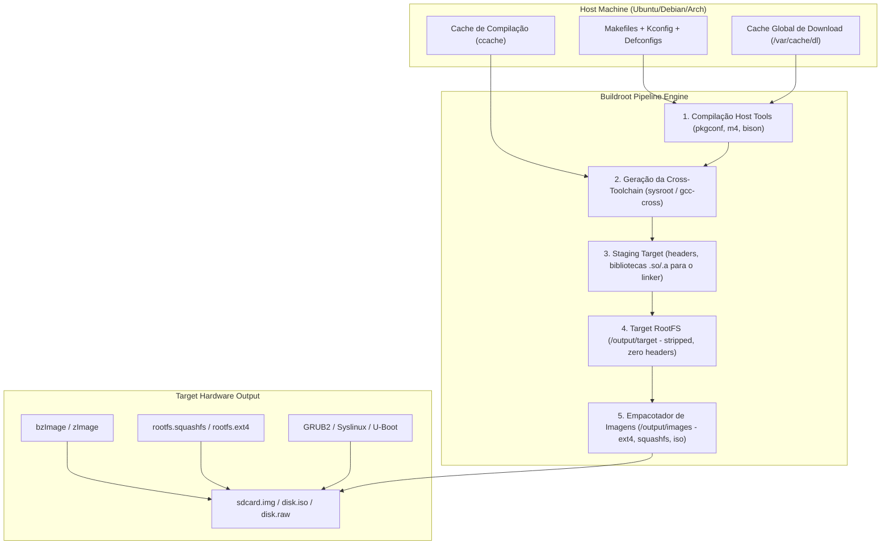

### 1.1 A Estrutura dos Diretórios de Saída (`output/`)

Ao executar o `make` no Buildroot, o diretório `output/` é populado com a seguinte hierarquia estrita:

*   `output/host/`: Ferramentas que rodam na máquina host (ex: compilador cruzado `x86_64-buildroot-linux-gnu-gcc`, `genimage`, `mksquashfs`, `fakeroot`).
*   `output/build/`: Árvore de descompactação e compilação de cada pacote (`linux-6.x`, `busybox`, `python3`, etc.). É aqui que ficam os arquivos `.stamp_*` que controlam o ciclo de vida do build.
*   `output/staging/`: Aponta simbolicamente para `output/host/<tuple>/sysroot/`. Contém todos os headers C (`.h`), bibliotecas estáticas (`.a`) e compartilhadas (`.so`) com símbolos de resolução para que outros pacotes possam linkar durante a compilação. **Este diretório NUNCA vai para o dispositivo embarcado.**
*   `output/target/`: O protótipo exato do sistema de arquivos do dispositivo. Todos os binários e bibliotecas aqui são *stripped* (símbolos de debug removidos com `strip`), arquivos `.h` e documentações `man` são sumariamente eliminados para poupar espaço em flash.
*   `output/images/`: O resultado final da engenharia: imagens de kernel, initramfs, tarballs e arquivos de partição prontos para deploy.

---

## 2. Matriz de Arquiteturas de Hardware

Embora o nosso foco central neste manual envolva as arquiteturas **x86_64** (SBCs industriais, gateways de rede, hardware enterprise) e **i386** (sistemas legados industriais, thin clients, x86 de 32 bits como Vortex86, Geode e Pentium clássicos), o Buildroot é agnóstico. A tabela a seguir consolida todas as arquiteturas suportadas com suas características de engenharia:

| Arquitetura (ISA) | Bits | Endianness | ABI Típica | Float ABI Model | Toolchain Tuple Padrão | Cenários Embarcados Reais |
| :--- | :--- | :--- | :--- | :--- | :--- | :--- |
| **x86_64 (AMD64)** | 64 | Little | SysV AMD64 | Hardware (SSE2/AVX) | `x86_64-buildroot-linux-gnu` / `musl` | Gateways industriais, IPCs Advantech, servidores edge, caixas de rede. |
| **i386 / i686** | 32 | Little | cdecl / System V | Hardware (x87/SSE) ou Soft | `i686-buildroot-linux-gnu` / `musl` | Automação fabril legada, Vortex86DX, terminal PDV legado, thin clients antigos. |
| **ARM (ARMv7-A)** | 32 | Little (maioria) | EABI / EABIhf | softfp / hard-float (VFPv3/NEON) | `arm-buildroot-linux-gnueabihf` | Raspberry Pi 2/3 (32-bit), NXP i.MX6/i.MX7, BeagleBone Black, Allwinner H3. |
| **AArch64 (ARMv8/v9)** | 64 | Little | LP64 | Hardware (FP + NEON + SVE) | `aarch64-buildroot-linux-gnu` / `musl` | Raspberry Pi 4/5, NVIDIA Jetson, NXP i.MX8, Rockchip RK3588, routers Wi-Fi 6/7. |
| **RISC-V 64 (RV64GC)** | 64 | Little | LP64D | Hardware (Double Precision FP) | `riscv64-buildroot-linux-gnu` | StarFive JH7110, Allwinner D1s (64-bit), placas Sipeed Lichee Pi 4A. |
| **RISC-V 32 (RV32IMAC)**| 32 | Little | ILP32 / ILP32D | Soft ou Hard Float | `riscv32-buildroot-linux-gnu` | MCUs inteligentes com Linux NoMMU/MMU, edge IoT de ultra baixo consumo. |
| **MIPS32 / MIPS64** | 32/64 | Bi-endian (mipsel) | o32 / n64 | Soft-float ou Hard-float | `mipsel-buildroot-linux-gnu` / `uclibc` | Roteadores domésticos legados (MediaTek MT7628, Atheros AR9331). |
| **PowerPC (e500/ppc64)** | 32/64 | Big / Little (ppc64le)| SPE / ELFv2 | Classic FPU ou SPE | `powerpc-buildroot-linux-gnu` | Equipamentos de telecomunicações antigos, aeronáutica, NXP QorIQ. |
| **Xtensa** | 32 | Little | Windowed / Call0 | Configurável (FPU custom) | `xtensa-buildroot-linux-uclibc` | Processadores DSP de áudio, co-processadores Wi-Fi/Bluetooth, ESP32 (NoMMU). |
| **ARC (ARCv2)** | 32 | Little | v2 / Compact | Soft ou Hard Float | `arc-buildroot-linux-uclibc` | Silício customizado Synopsys, smart meters, SoCs de televisores e decodificadores. |

### 2.1 Particularidades de x86_64 e i386 no Buildroot

Ao compilar para arquiteturas x86 no Buildroot, encontramos um fenômeno particular: o host da maioria dos desenvolvedores já é x86_64. No entanto, **o Buildroot nunca usa os compiladores ou bibliotecas do sistema hospedeiro** para gerar o RootFS. Ele constrói uma cross-toolchain isolada (ou importa uma toolchain externa Bootlin formalmente higienizada) com sysroot próprio para prevenir o chamado *Host Poisoning* (quando headers locais de `/usr/include` vazam para o firmware embarcado).

*   **x86_64**: Requer atenção com as instruções baseline (SSE3, SSE4.2, AVX). Definir um target de CPU muito alto (`skylake`) impede o boot em processadores Intel Atom ou AMD Geode modernos.
*   **i386**: A opção padrão deve ser validada contra a ausência de certas instruções atômicas em chips de 32 bits ultra-antigos (como CPUs 486 sem instrução `cmpxchg8b`, o que quebra certas implementações de NPTL e Rust). Para compatibilidade ampla, o baseline ideal é **i686 / Pentium Pro**.

---

## 3. Dinâmica de Compilação, Compiladores e Bibliotecas C (C Runtimes)

A biblioteca C (libc) é a fundação de todo o ecossistema user-space em Linux. Ela faz a ponte entre as chamadas de sistema do Kernel (`syscalls`) e os programas de alto nível. A escolha da libc define o consumo de RAM, a velocidade de boot, o tamanho do disco e a compatibilidade de código.

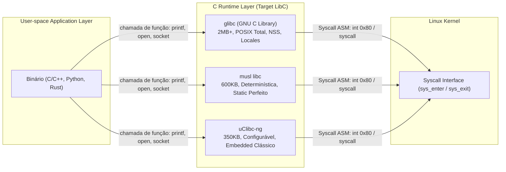

### 3.1 Comparativo das Bibliotecas C Disponíveis no Buildroot

#### 1. `glibc` (GNU C Library)
*   **Tamanho em Flash:** ~2.5 MB a 4.5 MB.
*   **Vantagens:** 100% compatível com a totalidade dos softwares de desktop e servidores existentes. Suporte completo a todas as extensões GNU, Name Service Switch (`/etc/nsswitch.conf`), PAM, internacionalização (`locales`), debugging avançado e `dlopen()` irrestrito.
*   **Desvantagens:** Overhead de memória considerável para nós IoT com menos de 32MB de RAM. **Terrível para compilação estática total** (veja abaixo).

#### 2. `musl` libc
*   **Tamanho em Flash:** ~600 KB a 900 KB.
*   **Vantagens:** Arquitetura extremamente limpa, estrita conformidade com os padrões POSIX, implementação de threads NPTL ultra-eficiente e leve. **É o padrão ouro para compilação estática (`-static`)**.
*   **Desvantagens:** Não suporta o mecanismo GNU NSS (não usa bibliotecas dinâmicas `libnss_*.so` para resolução de nomes). Certos softwares legados que dependem de comportamentos não documentados de glibc exigem patches de código para compilar.

#### 3. `uClibc-ng`
*   **Tamanho em Flash:** ~300 KB a 500 KB.
*   **Vantagens:** Altamente customizável através de seu próprio menuconfig interno. Permite desligar suporte a ponto flutuante, IPv6, RPC e WCHAR para atingir tamanhos microscópicos. Suporta arquiteturas sem MMU (noMMU).
*   **Desvantagens:** Ciclo de lançamentos mais lento, incompatibilidade com certas ferramentas C++ modernas e runtimes de linguagens recentes como Rust e Go.

### 3.2 Dinâmica de Compilação: Dinâmica vs. Estática

| Característica | Dynamic Linking (`.so`) | Static Linking (`.a`) |
| :--- | :--- | :--- |
| **Resolução de Símbolos** | Em tempo de execução pelo Dynamic Linker (`/lib/ld-linux*.so`) | Em tempo de compilação pelo Linker estático (`ld`) |
| **Consumo de Flash** | Baixo no agregado (bibliotecas são compartilhadas entre binários) | Alto (cada binário replica o código da libc e de dependências) |
| **Consumo de RAM** | Excelente (código das páginas de `.so` é compartilhado em memória) | Ruim (cada processo aloca suas próprias cópias de rotinas de libc) |
| **Segurança e ASLR** | Total com PIE (*Position Independent Executable*) | Requer toolchain com suporte a `static-pie` para ASLR funcional |
| **Isolamento de Erros** | Atualização de uma `.so` corrige vulnerabilidades em todos os binários | Cada binário vulnerável precisa ser recompilado individualmente |
| **Dependência de Sistema** | Frágil: falha fatal se o interpretador ou `.so` faltarem | Total: roda de forma 100% autônoma até dentro de um container scratch |

#### O Perigo Crítico de `glibc` Estático vs A Supremacia do `musl` Estático
Um erro comum de engenharia é tentar gerar binários 100% estáticos com `glibc` usando `gcc -static`.
*   O `glibc` implementa funções como `getpwnam()`, `gethostbyname()` e `getaddrinfo()` através de carregamento dinâmico em tempo de execução via `dlopen()` das bibliotecas `libnss_files.so` e `libnss_dns.so`.
*   Ao compilar com `gcc -static`, o linker emite o aviso clássico:
    `warning: Using 'getaddrinfo' in statically linked applications requires at runtime the shared libraries from the glibc version used for linking`.
*   Se o seu rootfs não tiver as bibliotecas dinâmicas exatas da mesma versão do glibc compilador, seu binário estático sofrerá crash ou falha de resolução DNS em produção!
*   **Solução:** Se o requisito de projeto for **binários 100% estáticos**, utilize obrigatoriamente a toolchain com **`musl`**. O `musl` implementa resolução DNS e banco de dados de usuários diretamente no código estático, sem invocar `dlopen()`.

---

## 4. Infraestrutura de Cache e Compilação de Alta Performance

A compilação de um sistema operacional do zero envolve a compilação cruzada de uma toolchain inteira, do kernel Linux e de dezenas ou centenas de pacotes. Sem técnicas de otimização, um build limpo pode levar de 40 minutos a 2 horas. Com a infraestrutura descrita nesta seção, os tempos caem para **menos de 3 minutos em builds incrementais**.

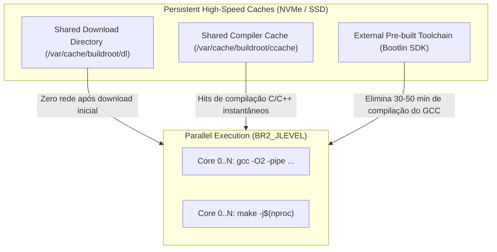

### 4.1 Compartilhamento Global do Diretório de Downloads (`BR2_DL_DIR`)

Por padrão, o Buildroot faz download dos tarballs de código-fonte dentro de `buildroot/dl/`. Se você tiver múltiplos projetos ou limpar a pasta do projeto, ele baixará tudo novamente pela internet.

Defina um diretório global de download no seu host:
```bash
sudo mkdir -p /var/cache/buildroot/dl
sudo chown -R $USER:$USER /var/cache/buildroot/dl
chmod 775 /var/cache/buildroot/dl
```
No `menuconfig`:
`Build options` ---> `($(HOME)/dl) Download dir`
Altere para:
`/var/cache/buildroot/dl`
Ou defina a variável de ambiente:
```bash
export BR2_DL_DIR="/var/cache/buildroot/dl"
```

### 4.2 Aceleração Máxima com `ccache` (`BR2_CCACHE`)

O `ccache` armazena em cache o resultado do pré-processamento e compilação de código C/C++. Em limpezas de build (`make clean`), o tempo de recompilação do GCC cai drasticamente porque quase 100% dos objetos compilados resultam em *cache hit*.

No `menuconfig`:
`Build options` --->
`[*] Enable compiler cache`
`($(HOME)/.buildroot-ccache) Compiler cache location` -> Altere para `/var/cache/buildroot/ccache`
`(50G) Compiler cache size` -> Configure de 30G a 50G dependendo do seu disco.

Para inspecionar as estatísticas do cache:
```bash
/home/cosmic/workspace/witchcraft_fex/bloodmoon-os/buildroot/output/host/bin/ccache -s
```

### 4.3 Paralelismo Agressivo (`BR2_JLEVEL`)

No `menuconfig`:
`Build options` --->
`Number of jobs to run simultaneously (0 for auto)`
Configure como `0`. O Buildroot detectará o número de núcleos (`nproc`) e executará a compilação paralela máxima (`nproc + 1`).

### 4.4 Isolamento com Builds Fora da Árvore (Out-of-Tree Builds)

Nunca polua a árvore de código-fonte do Buildroot. Utilize a flag `O=` para direcionar os artefatos para um diretório específico de montagem em disco de alta velocidade (ex: partição NVMe ou ramdisk):
```bash
cd /caminho/do/buildroot
make O=/caminho/do/workspace/build_x86_64 nt_defconfig
cd /caminho/do/workspace/build_x86_64
make menuconfig
make
```

### 4.5 Economia Radical com Toolchain Externa (Bootlin)

Construir a toolchain do zero (GCC + Binutils + Glibc) consome mais de 60% do tempo inicial do build. O Buildroot permite utilizar toolchains externas pré-compiladas pela Bootlin (antiga Free Electrons), que são validadas pela comunidade:
No `menuconfig`:
`Toolchain` --->
`Toolchain type (External toolchain)`
`Toolchain (Bootlin toolchains)`
`Toolchain origin (Toolchain to be downloaded and installed)`
Ao selecionar essa opção, o Buildroot baixa a toolchain estéril em 1 minuto e parte imediatamente para a compilação dos pacotes do SO.

### 4.6 Dominando os Stamps de Rebuild Incremental

Quando um pacote falha ou você altera uma opção de configuração, você **não** deve executar `make clean`. Você pode gerenciar os *stamps* em `output/build/<pacote>-<versão>/`:
*   `make <pacote>-rebuild`: Remove o stamp `.stamp_built` e recompila apenas o pacote e os estágios subsequentes.
*   `make <pacote>-reconfigure`: Remove os stamps de configuração e compilação, rodando o `configure` novamente.
*   `make <pacote>-dirclean`: Apaga completamente o diretório de build do pacote especificado.

---

## 5. Dissecação Exaustiva dos 9 Menus do Menuconfig

A interface do `make menuconfig` é organizada em 9 eixos fundamentais. Abaixo está a análise estrutural, técnica e prática de cada um deles.

```
+-------------------------------------------------------------------------------+
|                           Buildroot Menuconfig Hierarchy                      |
+-------------------------------------------------------------------------------+
|  1. Target options        -> Arquitetura, ISA, CPU Subtype, Floating Point    |
|  2. Build options         -> Cache, Diretórios, Strip, Flags, Segurança       |
|  3. Toolchain             -> LibC, Versão GCC, Headers, Threads, C++/Rust    |
|  4. System configuration  -> Hostname, Init (Busybox/Systemd), Overlays, Root |
|  5. Kernel                -> Versão Linux, DTS, Módulos, In-tree vs Custom    |
|  6. Target packages       -> Catálogo de Softwares, Runtimes, Shells, Daemons |
|  7. Filesystem images     -> Formatos de Disco (SquashFS, EROFS, Ext4, ISO)   |
|  8. Bootloaders           -> GRUB2, Syslinux, U-Boot, EFI Bootloaders         |
|  9. Host utilities        -> Geradores de Imagem e Ferramentas para o Host    |
+-------------------------------------------------------------------------------+
```

---

### Menu 1: Target Options

Define a plataforma de execução dos binários de target.

*   **`Target Architecture` (`BR2_ARCH`)**: Define a arquitetura do processador (`i386`, `x86_64`, `arm`, `aarch64`, `riscv64`, etc.). Essa escolha dita a geração das diretivas de montagem do compilador.
*   **`Target Architecture Variant` (`BR2_ARCH_VARIANT`)**:
    *   Para `x86_64`: Opções como `generic`, `core2`, `nehalem`, `silvermont`, `skylake`, `zen`. Escolher uma variante superior injeta flags `-march=<variante>` no compilador, ativando conjuntos de instruções modernos (como BMI2, FMA, AVX-512), mas quebrando a execução em processadores anteriores. Para compatibilidade industrial universal, utilize `generic`.
    *   Para `i386`: Opções como `i486`, `i586`, `i686`, `pentium3`, `pentium4`, `geode`. O `i686` é o ponto de equilíbrio recomendado.
*   **`Target ABI` (`BR2_GCC_TARGET_ABI`)**: No ecossistema x86_64, adota-se o padrão da ABI System V AMD64 (`LP64`). Em plataformas ARM/MIPS, define convenções de chamada como `EABIhf` ou `o32/n64`.
*   **`Floating point strategy` (`BR2_GCC_TARGET_FP32_MODE`)**: Configura o uso de FPU de hardware (SSE/SSE2 em x86) ou emulação por software (`soft-float`), essencial para microprocessadores industriais sem coprocessador aritmético.

---

### Menu 2: Build Options

Configura o comportamento do pipeline do Buildroot, diretórios locais, flags de hardening e sanitização.

*   **`Commands`**:
    *   `Number of jobs to run simultaneously (`BR2_JLEVEL`)`: Quantidade de threads do compilador (`make -j`). Deve ser setado para 0 para uso de todos os cores disponíveis.
*   **`Directories`**:
    *   `Download dir (`BR2_DL_DIR`)`: Caminho para o repositório central de pacotes fonte.
    *   `Host dir (`BR2_HOST_DIR`)`: Onde as ferramentas do host e a cross-toolchain são instaladas (padrão: `output/host`).
*   **`Compiler cache`**:
    *   `Enable compiler cache (`BR2_CCACHE`)`: Ativa o ccache para compilações ultra-rápidas.
    *   `Compiler cache location (`BR2_CCACHE_DIR`)`: Caminho persistente do cache.
*   **`Build packages with debugging symbols` (`BR2_ENABLE_DEBUG`)**: Injeta a flag `-g` na compilação de todos os pacotes. Não aumentará o tamanho da imagem final se o strip estiver ativo, mas é essencial para depuração com GDB.
*   **`Strip target binaries` (`BR2_STRIP_strip`)**: Executa `strip --strip-all` em todos os executáveis e bibliotecas antes da geração da imagem final. Reduz o tamanho do RootFS em até 70%, removendo tabelas de símbolos e seções de debug ELF desnecessárias para a execução.
*   **`Security Hardening Options`**:
    *   `Stack Smashing Protection (`BR2_SSP_ALL`)`: Injeta `-fstack-protector-all`. Insere canários de pilha para impedir ataques de buffer overflow.
    *   `RELRO (Relocation Read-Only) (`BR2_RELRO_FULL`)`: Faz o linker marcar a Global Offset Table (`GOT`) como somente leitura após o carregamento inicial, mitigando técnicas de sobrescrita de ponteiros de funções em memória.
    *   `Build code with Position Independent Execution (PIE) (`BR2_PIC_PIE`)`: Compila todos os binários de target como executáveis com posições independentes, permitindo que o Kernel Linux aplique ASLR (*Address Space Layout Randomization*) completo na pilha, heap e código.

---

### Menu 3: Toolchain

O coração de engenharia do sistema. Configura a geração do compilador, bibliotecas e headers.

*   **`Toolchain type` (`BR2_TOOLCHAIN_BUILDROOT` vs `BR2_TOOLCHAIN_EXTERNAL`)**: Define se o Buildroot compilará a toolchain a partir dos fontes ou se consumirá uma toolchain externa pré-construída.
*   **`C library` (`BR2_TOOLCHAIN_BUILDROOT_GLIBC`, `_MUSL`, `_UCLIBC`)**:
    *   Seleciona a libc alvo de acordo com os critérios analisados na Seção 3.
*   **`Kernel Headers` (`BR2_KERNEL_HEADERS_VERSION`)**: Define a versão dos headers de interface da API do Kernel (`linux-headers`). **Regra de ouro da engenharia Linux:** A versão dos kernel headers na toolchain deve ser **igual ou inferior** à versão do Kernel Linux que executará na máquina real.
*   **`Custom kernel headers series`**: Permite travar na série LTS desejada (ex: `6.1.x`, `6.6.x`).
*   **`GCC compiler Version` (`BR2_GCC_VERSION`)**: Seleciona a versão do GCC (ex: GCC 12.x, GCC 13.x, GCC 14.x). Versões mais recentes oferecem melhorias em otimização vetorial e suporte aos novos padrões C23/C++23.
*   **`Enable C++ support` (`BR2_INSTALL_LIBSTDCPP`)**: Ativa a compilação do `libstdc++`. Obrigatório para qualquer software que utilize C++ (Node.js, Chromium, Qt, ferramentas de rede modernas).
*   **`Enable Fortran / D / Go / Rust support`**:
    *   `BR2_PACKAGE_HOST_RUSTC`: Ativa o compilador Rust para cross-compilação no host, viabilizando softwares e utilitários modernos escritos em Rust.
*   **`Enable thread support` (`BR2_TOOLCHAIN_HAS_THREADS`)**: Habilita suporte a threads POSIX (NPTL - Native POSIX Thread Library).
*   **`Enable WCHAR support` (`BR2_USE_WCHAR`)**: Suporte a caracteres largos (Unicode). Quase todos os pacotes modernos (incluindo Python e Zsh) exigem essa opção ativada.
*   **`Enable Enable locale support` (`BR2_ENABLE_LOCALE`)**: Habilita suporte a internacionalização e múltiplos idiomas. Disponível apenas em `glibc` e `uClibc-ng` configurado.

---

### Menu 4: System Configuration

Configura as propriedades de identidade do sistema operacional, estrutura do init e políticas do RootFS.

*   **`System hostname` (`BR2_TARGET_GENERIC_HOSTNAME`)**: O nome de rede do dispositivo (gravado em `/etc/hostname`).
*   **`System banner` (`BR2_TARGET_GENERIC_ISSUE`)**: Mensagem exibida no terminal/TTY antes do login (gravado em `/etc/issue`).
*   **`Init system` (`BR2_INIT_BUSYBOX`, `BR2_INIT_SYSV`, `BR2_INIT_SYSTEMD`, `BR2_INIT_NONE`)**:
    *   `BusyBox`: O init mais leve possível. Lê `/etc/inittab`, executa scripts sequenciais em `/etc/init.d/rcS`. Tempo de boot: < 1 segundo.
    *   `Systemd`: O padrão enterprise moderno. Suporte nativo a cgroups v2, journald, ativação por socket, inicialização paralela de serviços. Exige `glibc` ou `musl` avançado, adicionando ~30MB ao RootFS.
    *   `SysVinit`: O modelo clássico de runlevels UNIX com scripts de inicialização tradicionais.
*   **`/dev management` (`BR2_ROOTFS_DEVICE_CREATION_DYNAMIC_EUDEV`, `_MDEV`, `_DEVTMPFS`)**:
    *   `devtmpfs only`: O Kernel popula o `/dev` automaticamente.
    *   `mdev (BusyBox)`: Daemon ultraleve que processa eventos de hotplug de hardware executando regras em `/etc/mdev.conf`.
    *   `eudev`: Fork standalone do daemon udev do systemd. Ideal para suporte dinâmico a dispositivos USB, discos e placas de rede sem exigir o systemd completo.
*   **`Root password` (`BR2_TARGET_GENERIC_ROOT_PASSWD`)**: Define a senha de root. O Buildroot gera o hash criptográfico (usando SHA-512) diretamente em `/etc/shadow`.
*   **`Root filesystem overlay directories` (`BR2_ROOTFS_OVERLAY`)**:
    *   Caminho para uma árvore de diretórios no seu host (ex: `board/minha-empresa/rootfs-overlay`).
    *   Durante a finalização do RootFS, o Buildroot copia todo o conteúdo dessa pasta para dentro do target, permitindo sobrescrever arquivos de configuração (`/etc/fstab`, `/etc/network/interfaces`) ou injetar arquivos arbitrários.
*   **`Custom scripts to run before creating filesystem images` (`BR2_ROOTFS_POST_BUILD_SCRIPT`)**:
    *   Executa um script shell antes de empacotar a imagem final.
    *   O script recebe o caminho para `$TARGET_DIR` como primeiro argumento (`$1`), permitindo alterar permissões (`chmod`), remover arquivos desnecessários ou gerar arquivos dinâmicos.
*   **`Custom scripts to run after creating filesystem images` (`BR2_ROOTFS_POST_IMAGE_SCRIPT`)**:
    *   Executa scripts após a geração das imagens (recebe `$BINARIES_DIR` como primeiro argumento). Utilizado para chamar ferramentas como `genimage`, que criam a imagem final particionada (`sdcard.img` ou `disk.raw`).

---

### Menu 5: Kernel

Configura a compilação do Kernel Linux oficial.

*   **`Linux Kernel` (`BR2_LINUX_KERNEL=y`)**: Ativa a compilação do Kernel no pipeline.
*   **`Kernel Version` (`BR2_LINUX_KERNEL_LATEST_VERSION`, `_CUSTOM_VERSION`, `_CUSTOM_TARBALL`, `_CUSTOM_GIT`)**:
    *   Permite selecionar uma versão LTS pré-definida pelo Buildroot ou apontar para uma URL Git customizada contendo um kernel proprietário com drivers específicos de placa.
*   **`Kernel configuration`**:
    *   `Using an in-tree defconfig file (`BR2_LINUX_KERNEL_USE_DEFCONFIG`)`: Utiliza um arquivo da árvore oficial do Kernel (ex: `x86_64_defconfig` para PCs 64-bit ou `i386_defconfig`).
    *   `Using a custom (def)config file (`BR2_LINUX_KERNEL_USE_CUSTOM_CONFIG`)`: Aponta para um arquivo de configuração consolidado do kernel mantido pela sua equipe.
    *   `Additional configuration fragment files (`BR2_LINUX_KERNEL_CONFIG_FRAGMENT_FILES`)`: Caminhos para arquivos `.config` parciais que são mesclados com o defconfig base (ideal para ativar drivers específicos de Wi-Fi, WireGuard ou virtualização KVM sem alterar o arquivo base).
*   **`Kernel binary format` (`BR2_LINUX_KERNEL_BZIMAGE`, `_ZIMAGE`, `_IMAGE`)**:
    *   Para x86 e x86_64: O padrão obrigatório é **`bzImage`** (*big zImage*, executável PE/COFF comprimido suportado por BIOS/UEFI e GRUB).
    *   Para ARM: `zImage` (32 bits) ou `Image` / `Image.gz` (64 bits AArch64).
*   **`Device Tree support` (`BR2_LINUX_KERNEL_DTS_SUPPORT`)**:
    *   Em arquiteturas ARM, RISC-V e MIPS, ativa a compilação de Device Tree Source (`.dts`) em Device Tree Blob (`.dtb`).
    *   Em arquiteturas x86_64 e i386, **o Device Tree fica desativado**, pois a descoberta de hardware no mundo PC é realizada em tempo de boot via ACPI e varredura do barramento PCI.

---

### Menu 6: Target Packages

O repositório de softwares disponíveis para inclusão no RootFS. É subdividido em categorias temáticas:

*   **`Audio and video applications`**: FFmpeg, ALSA, GStreamer, mpv.
*   **`Compressors and decompressors`**: `zstd`, `xz`, `gzip`, `tar`, `bzip2`.
*   **`Debugging, profiling and benchmark`**: `gdb`, `strace`, `ltrace`, `perf`, `valgrind`, `htop`.
*   **`Development tools`**: `binutils`, `git`, `make`, `tree`.
*   **`Filesystem and flash utilities`**: `e2fsprogs` (fsck, mkfs.ext4), `btrfs-progs`, `dosfstools`, `mtd-utils`, `f2fs-tools`.
*   **`Hardware handling`**: `pciutils` (lspci), `usbutils` (lsusb), `ethtool`, `acpid`, `flashrom`.
*   **`Interpreter languages and scripting`**:
    *   `Python 3`: Ambiente de execução e módulos.
    *   `MicroPython`: O runtime de alta eficiência.
    *   `Lua / LuaJIT`, `Perl`, `PHP`, `Node.js`.
*   **`Libraries`**:
    *   Crypto: `OpenSSL` (libcrypto, libssl), `mbedtls`, `gnutls`.
    *   Networking: `libcurl`, `libmicrohttpd`, `libnl`.
    *   Graphics: `Wayland`, `Weston`, `Qt5 / Qt6`, `Mesa3D`.
*   **`Networking applications`**: `iptables`, `nftables`, `openssh` (sshd, scp, sftp), `dropbear` (servidor SSH ultraleve alternativo), `wireguard-tools`, `nginx`, `socat`, `tcpdump`, `curl`, `rsync`.
*   **`Shell and utilities`**: `bash`, `zsh`, `tmux`, `screen`, `sudo`, `file`.
*   **`Text editors and viewers`**: `vim`, `nano`, `less`, `mc` (Midnight Commander).

---

### Menu 7: Filesystem Images

Configura o empacotador de partições e os formatos dos sistemas de arquivos a serem gerados. A dissecação técnica e minuciosa de cada formato e algoritmo deste menu é apresentada detalhadamente na **Seção 8**.

*   `ext2/3/4 root filesystem` (`BR2_TARGET_ROOTFS_EXT2`)
*   `squashfs root filesystem` (`BR2_TARGET_ROOTFS_SQUASHFS`)
*   `erofs root filesystem` (`BR2_TARGET_ROOTFS_EROFS`)
*   `cpio the root filesystem (for use as an initial RAM filesystem)` (`BR2_TARGET_ROOTFS_CPIO`)
*   `tar the root filesystem` (`BR2_TARGET_ROOTFS_TAR`)
*   `iso image` (`BR2_TARGET_ROOTFS_ISO9660`)
*   `ubifs root filesystem` (`BR2_TARGET_ROOTFS_UBIFS`)
*   `jffs2 root filesystem` (`BR2_TARGET_ROOTFS_JFFS2`)
*   `btrfs root filesystem` (`BR2_TARGET_ROOTFS_BTRFS`)
*   `f2fs root filesystem` (`BR2_TARGET_ROOTFS_F2FS`)

---

### Menu 8: Bootloaders

Configura o código que assume o controle da máquina ao ligar e transfere o contexto para o Kernel Linux.

*   **`GRUB2` (`BR2_TARGET_GRUB2`)**: O bootloader universal para x86 e x86_64.
    *   `Platform`:
        *   `i386-pc`: Para computadores legados inicializados via BIOS clássica (Master Boot Record).
        *   `i386-efi`: Para dispositivos x86 antigos com firmware UEFI de 32 bits (comum em certos tablets Intel Atom antigos).
        *   `x86_64-efi`: O padrão moderno da totalidade dos computadores x86_64 atuais com UEFI e Secure Boot.
    *   `Install tools`: Instala utilitários como `grub-editenv` no sistema de arquivos de destino.
*   **`Syslinux / Extlinux` (`BR2_TARGET_SYSLINUX`)**: Bootloader ultraleve para plataformas x86 BIOS. Muito utilizado em pen-drives e cartões de memória por sua configuração minimalista baseada em um simples arquivo de texto `syslinux.cfg`.
*   **`U-Boot` (`BR2_TARGET_UBOOT`)**: O padrão soberano para sistemas embarcados ARM, RISC-V e MIPS. Inicializa relógios, controladores de memória DDR, barramentos I2C/SPI e carrega o Kernel e a Device Tree Blob (`.dtb`) na memória RAM.
*   **`systemd-boot` (`BR2_TARGET_SYSTEMD_BOOT`)**: Carregador de boot UEFI simples e rápido disponível quando o systemd é selecionado como init.

---

### Menu 9: Host Utilities

Ferramentas que o Buildroot compila especificamente para rodar na máquina host do desenvolvedor para viabilizar testes, particionamento e empacotamento de imagens de disco.

*   **`host genimage` (`BR2_PACKAGE_HOST_GENIMAGE`)**: Ferramenta essencial que lê um arquivo de configuração declarativo (`genimage.cfg`) e constrói imagens de disco particionadas completas (contendo tabela GPT ou MBR, partições de boot EFI VFAT e partições de RootFS).
*   **`host mtools` e `host dosfstools`**: Permitem criar e manipular sistemas de arquivos FAT/FAT32 no host sem exigir privilégios de `root` (`sudo`).
*   **`host e2fsprogs`**: Utilitários `mkfs.ext4` para o host criar imagens ext4 perfeitamente dimensionadas.
*   **`host qemu` (`BR2_PACKAGE_HOST_QEMU`)**: Compila o emulador QEMU no host para permitir a execução automatizada de testes do kernel e do rootfs recém-compilados diretamente pelo terminal.

---

## 6. Integração de Binários Externos e Resolução de Linkers

Na indústria, é extremamente comum a necessidade de incorporar **binários pré-compilados**, softwares proprietários fornecidos por terceiros (ex: daemons de telemetria, drivers proprietários, engines de segurança fechadas) aos quais a equipe não possui o código-fonte para compilar no Buildroot.

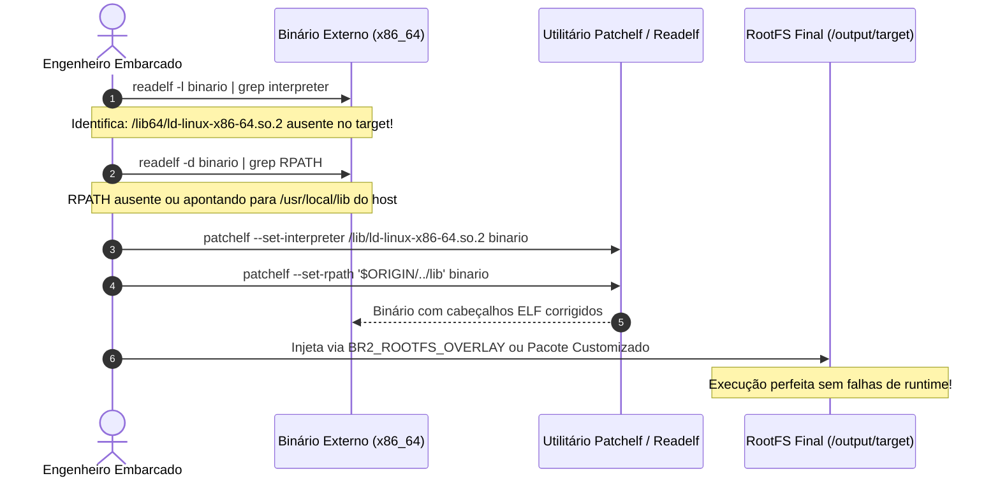

### 6.1 O Erro Fatídico: `sh: ./meu_binario: not found`

Quando você copia um binário executável para o seu sistema embarcado, atribui permissão de execução (`chmod +x meu_binario`) e ao rodá-lo recebe a mensagem:
```bash
# ./meu_binario
sh: ./meu_binario: not found
```
Mesmo o arquivo existindo visivelmente no diretório, o erro ocorre porque o **Dynamic Linker (ELF Program Interpreter)** requisitado pelo binário **não existe no sistema de arquivos**.

Para inspecionar o interpretador exigido pelo binário:
```bash
readelf -l meu_binario | grep interpreter
```
*Saída de exemplo:*
```text
[Requesting program interpreter: /lib64/ld-linux-x86-64.so.2]
```
Se o seu RootFS foi compilado com `musl`, o interpretador do sistema reside em `/lib/ld-musl-x86_64.so.1`. O kernel falha ao disparar o interpretador ausente e emite o erro `not found`.

Para inspecionar as dependências de bibliotecas compartilhadas:
```bash
readelf -d meu_binario | grep NEEDED
```

### 6.2 Modificação Cirúrgica de Cabeçalhos ELF com `patchelf`

O utilitário `patchelf` permite reescrever o interpretador ELF e a rota de busca de bibliotecas (`RPATH`) diretamente no binário sem necessidade do código-fonte:

1.  **Alterar o interpretador para a biblioteca do target:**
    ```bash
    patchelf --set-interpreter /lib/ld-linux-x86-64.so.2 meu_binario
    ```
    *(Ou `/lib/ld-musl-x86_64.so.1` caso o sistema use musl).*

2.  **Configurar o RPATH relativo usando `$ORIGIN`:**
    ```bash
    patchelf --set-rpath '$ORIGIN/../lib:/usr/lib' meu_binario
    ```
    Isso força o binário a procurar suas dependências `.so` dentro do diretório `lib` relativo ao local do binário ou na pasta central `/usr/lib`, prevenindo falhas de resolução.

### 6.3 Os Três Métodos Canônicos de Inclusão no Buildroot

#### Método A: Inclusão via RootFS Overlay (`BR2_ROOTFS_OVERLAY`)
O método mais rápido para binários estáticos ou scripts:
1. Crie uma pasta de overlay: `board/custom_board/rootfs-overlay/`
2. Posicione os arquivos respeitando a árvore exata do sistema Linux:
   ```text
   board/custom_board/rootfs-overlay/
   ├── usr/
   │   └── bin/
   │       └── meu_binario_externo
   └── etc/
       └── custom_service.conf
   ```
3. No `menuconfig`: `System configuration` -> `Root filesystem overlay directories` aponte para `board/custom_board/rootfs-overlay`.
4. Os arquivos serão copiados diretamente para o target com permissões preservadas.

#### Método B: Manipulação Dinâmica via Post-Build Script
Se você precisa baixar o binário de um servidor seguro interno ou aplicar comandos condicionais de `chmod`/`chown`:
Crie o script `board/custom_board/post_build.sh`:
```bash
#!/usr/bin/env bash
set -e
TARGET_DIR="$1"

echo "===> Aplicando pós-processamento de binários externos em: $TARGET_DIR"

# Instala um binário pré-compilado e ajusta permissões de execução
install -m 755 -D /opt/binarios_externos/agent_telemetria "$TARGET_DIR/usr/bin/agent_telemetria"

# Cria symlink se necessário
ln -sf /usr/bin/agent_telemetria "$TARGET_DIR/usr/bin/telemetria"

# Garante a permissão restrita de arquivos de configuração
if [ -f "$TARGET_DIR/etc/custom_service.conf" ]; then
    chmod 600 "$TARGET_DIR/etc/custom_service.conf"
fi
```
No `menuconfig`: `System configuration` -> `Custom scripts to run before creating filesystem images` aponte para `board/custom_board/post_build.sh`.

#### Método C: Pacote Declarativo Customizado no Buildroot
É a abordagem mais profissional e limpa, permitindo que o binário participe do cálculo de dependências do Make.
1. Crie o diretório do pacote: `package/meu-binario/`
2. Crie o arquivo `package/meu-binario/Config.in`:
   ```kconfig
   config BR2_PACKAGE_MEU_BINARIO
       bool "meu-binario"
       depends on BR2_x86_64
       help
         Binário de telemetria proprietário da arquitetura x86_64.
   ```
3. Crie o arquivo `package/meu-binario/meu-binario.mk`:
   ```makefile
   ################################################################################
   #
   # meu-binario
   #
   ################################################################################

   MEU_BINARIO_VERSION = 1.0.0
   MEU_BINARIO_SITE = $(TOPDIR)/../binarios_locais
   MEU_BINARIO_SITE_METHOD = local

   define MEU_BINARIO_INSTALL_TARGET_CMDS
       $(INSTALL) -D -m 0755 $(@D)/meu_binario_x86_64 $(TARGET_DIR)/usr/bin/meu_binario
   endef

   $(eval $(generic-package))
   ```
4. Registre o pacote no `package/Config.in` do Buildroot adicionando:
   ```kconfig
   source "package/meu-binario/Config.in"
   ```
Agora ele aparecerá normalmente na lista do `make menuconfig` em `Target packages`!

---

## 7. Inclusão de Pacotes Opcionais, Shells e Runtimes Modernos

### 7.1 Editores de Texto e Shells Avançados

#### Editores: `vim` vs `nano` vs `busybox vi`
*   Por padrão, o Buildroot provê o `vi` simplificado embutido no BusyBox. Ele consome zero bytes adicionais, mas carece de recursos como syntax highlighting, busca regex avançada e múltiplos buffers.
*   **Nano (`BR2_PACKAGE_NANO=y`)**: Ideal para sistemas operados por técnicos de campo que precisam de um editor simples e intuitivo no terminal. Adiciona ~300KB ao RootFS.
*   **Vim (`BR2_PACKAGE_VIM=y`)**: O editor completo. Para incluir syntax highlighting e runtime de cores sem estourar o tamanho do disco, configure:
    *   `BR2_PACKAGE_VIM_RUNTIME=y`: Instala os scripts de syntax e temas em `/usr/share/vim`.

#### Shells: `zsh` vs `bash` vs `busybox ash`
*   **BusyBox ash**: O shell padrão do sistema. Extremamente veloz, consome menos de 100KB de RAM por sessão.
*   **Bash (`BR2_PACKAGE_BASH=y`)**: Compatibilidade total com scripts shell complexos corporativos que dependem de arrays e bashismos (`[[ ... ]]`).
*   **Zsh (`BR2_PACKAGE_ZSH=y`)**: O shell preferido para ambientes de auditoria interativa e hackers.
    *   Requer biblioteca `ncurses` ativada.
    *   Para fornecer uma experiência avançada, injete um arquivo `.zshrc` estéril customizado através do `BR2_ROOTFS_OVERLAY` em `/etc/skel/.zshrc` e `/root/.zshrc`.

### 7.2 Runtimes de Linguagens de Programação

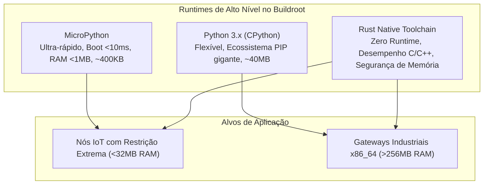

#### Python 3 (CPython)
*   Ativação: `Target packages` -> `Interpreter languages and scripting` -> `[*] python3` (`BR2_PACKAGE_PYTHON3=y`).
*   **Otimização de Tamanho:**
    *   `BR2_PACKAGE_PYTHON3_PYC_ONLY=y`: Remove todos os arquivos-fonte `.py` e mantém apenas os bytecodes compilados `.pyc`. Reduz o espaço em disco ocupado pelo Python em quase 40% e acelera o tempo de carga dos módulos.
    *   Módulos Core: Ative apenas o que for estritamente necessário: `BR2_PACKAGE_PYTHON3_SSL=y` para conexões HTTPS, `BR2_PACKAGE_PYTHON3_SQLITE=y` para banco de dados local, `BR2_PACKAGE_PYTHON3_ZLIB=y` para descompressão.
*   **Instalação de Pacotes Python Sem Conexão de Rede no Target:**
    *   Dispositivos embarcados muitas vezes operam em redes isoladas (air-gapped) e não possuem o utilitário `pip` nativo.
    *   O Buildroot possui centenas de pacotes Python declarados nativamente em `Target packages` -> `External python modules` (ex: `python-requests`, `python-pydantic`, `python-cryptography`, `python-serial`).
    *   Caso precise de uma biblioteca que não esteja na árvore, basta empacotá-la via infraestrutura `python-package` do Buildroot, gerando o download seguro no host.

#### MicroPython
*   Ativação: `Target packages` -> `Interpreter languages and scripting` -> `[*] micropython` (`BR2_PACKAGE_MICROPYTHON=y`).
*   **Quando utilizar:** Em computadores embarcados i386 ou ARM com pouca RAM ou necessidade de inicialização instantânea (<10ms).
*   O executável do MicroPython para Linux possui ~400 KB e provê a sintaxe padrão do Python 3 com um coletor de lixo ultra-compacto. Permite rodar scripts de controle, telemetria e leitura de portas seriais consumindo menos de 1 MB de memória RAM.

#### Rust Runtime & Softwares em Rust
*   Ativação: O Buildroot gerencia a compilação cruzada de softwares em Rust instalando o compilador `host-rustc` no host e linkando contra o target.
*   Pacotes nativos em Rust no Buildroot utilizam a infraestrutura declarativa `cargo-package`.
*   Exemplo de inclusão de softwares modernos em Rust (como utilitários de sistema de alta performance: `ripgrep`, `bat`, `bottom`, daemons de rede seguros): basta marcar o pacote desejado em `Target packages`, e o Buildroot orquestra o `cargo` cruzado de forma 100% automatizada.

---

## 8. Engenharia de Filesystems: Estudo Profundo de Todas as Opções

O menu `Filesystem images` do Buildroot define como os dados do RootFS serão estruturados e comprimidos em blocos de armazenamento físico. A escolha incorreta pode causar degradação precoce da memória flash ou lentidão no boot.

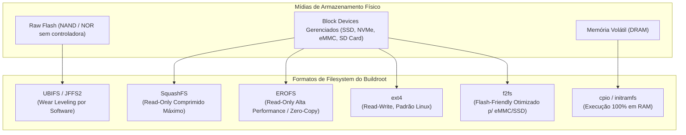

Abaixo está o estudo aprofundado de **todas** as opções de filesystem disponíveis no menu do Buildroot.

---

### 8.1 `ext2 / ext3 / ext4` (`BR2_TARGET_ROOTFS_EXT2`)

O padrão histórico do Linux para dispositivos de bloco gerenciados (discos SATA, NVMe, cartões SD com controladora FTL).

*   **`ext2`**: Não possui *journaling*. É o mais simples e realiza o menor número de escritas na mídia. No entanto, se houver queda de energia durante uma escrita, o sistema fica corrompido e exige uma varredura demorada (`fsck`) no boot seguinte.
*   **`ext3`**: Introduz o *journaling* básico em blocos. Protege a integridade do sistema contra desligamentos bruscos gravando metadados no journal antes de persistir no disco.
*   **`ext4` (`BR2_TARGET_ROOTFS_EXT2_4=y`)**: A evolução definitiva. Introduz *extents* (alocação contígua de blocos grandes, reduzindo fragmentação), timestamps em nanossegundos, alocação postergada (*delayed allocation*) e *checksums* de integridade no journal.
*   **Parâmetros de Engenharia no Buildroot:**
    *   `filesystem size (`BR2_TARGET_ROOTFS_EXT2_SIZE`)`: Tamanho total da partição (ex: `512M`, `2G`).
    *   `reserved blocks percentage (`BR2_TARGET_ROOTFS_EXT2_RESBLKS`)`: Por padrão, o Linux reserva 5% dos blocos para o usuário `root`. Em sistemas embarcados de função única, configure este valor para `0%` para disponibilizar todo o espaço do disco para a aplicação.
    *   `Inode count / Inode size`: Define o número máximo de arquivos que a partição pode conter. Em sistemas que manipulam milhares de pequenos arquivos de log, configure um valor de inodes superior ao padrão.

---

### 8.2 `squashfs` (`BR2_TARGET_ROOTFS_SQUASHFS`)

O padrão absoluto para sistemas de arquivos **somente-leitura** (*read-only*) de alta densidade no mundo embarcado. Todos os blocos de dados, inodes e diretórios são comprimidos individualmente.

*   **Comportamento:** O filesystem é imutável. Nenhum processo, nem mesmo o `root`, consegue alterar ou deletar arquivos dentro de um volume SquashFS em tempo de execução. Isso garante imunidade total contra corrupção acidental e persistência de malwares que tentem modificar binários de sistema.
*   **Algoritmos de Compressão (`BR2_TARGET_ROOTFS_SQUASHFS_...`):**
    *   `gzip`: Compatibilidade histórica com kernels muito antigos. Taxa de compressão média, descompressão rápida.
    *   `lzo`: Compressão rápida e **descompressão ultrarrápida**. Muito utilizado quando o gargalo principal do sistema é a taxa de clock do processador.
    *   `xz`: Utiliza o algoritmo LZMA2. Proporciona a **taxa de compressão máxima** (reduz o RootFS ao menor tamanho em MB possível). Porém, exige alto consumo de RAM e CPU no momento da descompressão em tempo de boot.
    *   `zstd` (Recomendado): Desenvolvido pelo Facebook/Meta. Combina taxas de compressão muito próximas ao `xz` com velocidades de descompressão que superam o `gzip` e se aproximam do `lzo`. É o algoritmo de compressão padrão para sistemas embarcados modernos.
*   **Opções de Otimização:**
    *   `Block size (`BR2_TARGET_ROOTFS_SQUASHFS_BLOCK_SIZE`)`: O padrão é 128KB ou 256KB. Blocos maiores aumentam a taxa de compressão em arquivos grandes; blocos menores aumentam a velocidade de leitura aleatória de pequenos executáveis.

---

### 8.3 `erofs` (Enhanced Read-Only File System - `BR2_TARGET_ROOTFS_EROFS`)

Projetado originalmente por engenheiros da Huawei para o ecossistema Android e integrado na linha principal do Kernel Linux a partir da versão 5.4.

*   **Vantagens Sobre o SquashFS:**
    *   **Zero-Copy Memory Cache:** O EROFS mapeia os blocos de dados descomprimidos diretamente nas páginas de cache da memória do Linux (*Page Cache*), eliminando a cópia intermediária de buffers de dados que o SquashFS realiza.
    *   **Performance Superior de Leitura Aleatória:** Em testes de benchmarking sob memórias flash de alta velocidade (NVMe/eMMC), o EROFS entrega até 3x mais IOPS e velocidade de abertura de binários que o SquashFS, com consumo de CPU consideravelmente menor.
*   **Algoritmos:** Suporta blocos sem compressão (alta velocidade pura) ou compressão via `lz4` (foco em latência ultrabaixa) e `lzma/zstd`.
*   **Aplicação Ideal:** Sistemas automotivos, dispositivos médicos e gateways edge x86_64 que exigem tempos de boot inferiores a 2 segundos com proteção total de imutabilidade.

---

### 8.4 `ubifs` & `jffs2` (Sistemas para Memórias Raw Flash)

Estes sistemas de arquivos são estritamente projetados para memórias **Raw NAND e Raw NOR** (chips de memória soldados diretamente na placa-mãe sem microcontrolador interno).

> [!CAUTION]
> **NUNCA grave ext4, btrfs ou fat em memórias Raw Flash.** Sistemas de arquivos tradicionais assumem que os setores de disco não sofrem desgaste ou que o hardware gerencia blocos ruins. Sem uma camada de *wear leveling*, uma partição ext4 destruirá permanentemente os blocos físicos de uma memória NAND em poucos dias de operação.

*   **`jffs2` (Journaling Flash File System v2 - `BR2_TARGET_ROOTFS_JFFS2`)**:
    *   Indicado apenas para memórias NOR antigas e muito pequenas (até 32 MB ou 64 MB).
    *   No momento do boot, o JFFS2 realiza uma varredura completa em toda a mídia para reconstruir o mapa do sistema de arquivos em RAM, tornando o tempo de boot inaceitável em discos maiores.
*   **`ubifs` (Unsorted Block Images File System - `BR2_TARGET_ROOTFS_UBIFS`)**:
    *   Projetado para memórias NAND modernas de grande porte (gigabytes).
    *   Não roda diretamente na partição MTD física; ele roda sobre a camada intermediária **UBI (Unsorted Block Images)**.
    *   A camada UBI gerencia o mapa de blocos danificados (*bad blocks*), distribui o desgaste das escritas homogeneamente por todos os chips de silício (*wear leveling dinâmico e estático*) e provê tolerância atômica a cortes repentinos de energia elétrica.

---

### 8.5 `cpio / initramfs` (`BR2_TARGET_ROOTFS_CPIO`)

Empacota o RootFS inteiro dentro de um arquivo de arquivo `cpio` (opcionalmente comprimido com gzip, xz ou zstd).

*   **Modalidade 1: Initramfs Externo**: O bootloader (GRUB2 ou U-Boot) carrega o kernel na memória RAM e carrega o arquivo `rootfs.cpio.gz` logo em seguida, passando o endereço de memória para o kernel via linha de comando.
*   **Modalidade 2: Initramfs Embutido no Kernel (`CONFIG_INITRAMFS_SOURCE`)**: O Buildroot instrui a compilação do Kernel Linux a incorporar o arquivo cpio **diretamente dentro do binário do Kernel (`bzImage`)**. O resultado é um único arquivo binário auto-suficiente: ao carregar o bzImage, o kernel descompacta o rootfs diretamente na memória RAM e inicia a execução instantaneamente.
*   **Uso Ideal:** Sistemas de recuperação (*rescue mode*), atualizadores de firmware OTA, instaladores de sistema e appliances stateless que operam 100% em memória volátil, ignorando completamente discos mecânicos.

---

### 8.6 `tar` (`BR2_TARGET_ROOTFS_TAR`)

Gera um tarball (`rootfs.tar`) contendo toda a árvore de arquivos, permissões UNIX e nós de dispositivos do sistema.

*   **Aplicações Práticas:**
    *   Base para criação de contêineres Docker/LXC ultraleves (`docker import rootfs.tar meu-os-embarcado:v1`).
    *   Descompactação manual por scripts de particionamento customizados de fábrica em linhas de montagem.
    *   Inspeção visual rápida pelo desenvolvedor no host (`tar -tvf rootfs.tar`).

---

### 8.7 `iso9660` (`BR2_TARGET_ROOTFS_ISO9660`)

Gera uma imagem no padrão ISO 9660 compatível com discos ópticos (CD/DVD) e mídias USB híbridas (Isophybrid).

*   **Uso no Buildroot:** Exclusivo para plataformas x86 e x86_64.
*   Integra o bootloader GRUB ou Isolook/Syslinux para permitir que o sistema inicialize diretamente de um pen-drive em modo Live em qualquer computador pessoal, notebook ou servidor x86 sem necessidade de particionar previamente a unidade.

---

### 8.8 `btrfs` & `f2fs` (Sistemas Avançados de Bloco)

*   **`f2fs` (Flash-Friendly File System - `BR2_TARGET_ROOTFS_F2FS`)**:
    *   Criado pela Samsung e desenhado especificamente para dispositivos de armazenamento modernos que possuem controladora FTL interna (cartões MicroSD industriais, chips eMMC soldados e SSDs NVMe).
    *   O F2FS utiliza uma estratégia baseada em log (*Log-structured File System*), agrupando gravações aleatórias em rajadas sequenciais contínuas. Isso reduz o fator de amplificação de escrita (*Write Amplification Factor - WAF*), dobrando a vida útil de memórias flash em ambientes industriais com alta intensidade de logs.
*   **`btrfs` (`BR2_TARGET_ROOTFS_BTRFS`)**:
    *   Sistema de arquivos com *Copy-on-Write* (CoW).
    *   Permite a criação instantânea de snapshots do sistema antes de atualizações críticas, possibilitando o rollback atômico em caso de falha de inicialização, além de suporte nativo a compressão transparente em tempo real (zstd em nível de bloco).

---

## 9. Arquitetura de Produção: Imutabilidade com Read-Only RootFS e OverlayFS

Para que um sistema operacional baseado em Linux atinja **confiabilidade de nível industrial (99.999% uptime)**, ele não pode ser montado em modo de leitura e escrita direta no disco raiz. Quedas repentinas de energia em campo durante escritas corrompem tabelas de alocação de arquivos.

A arquitetura recomendada pela engenharia é a segregação de partições:

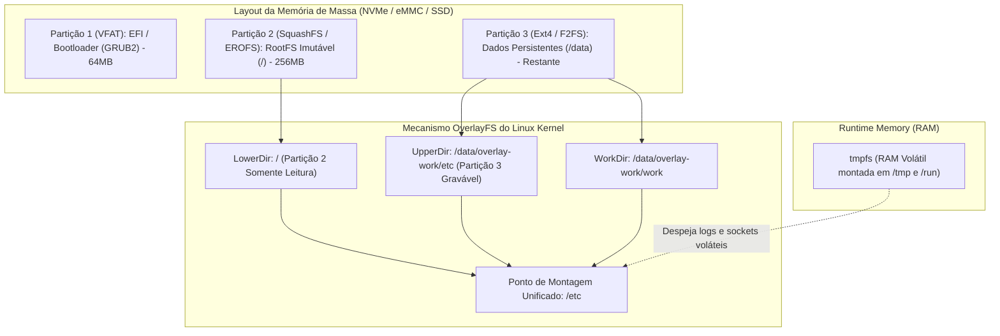

### 9.1 O Mecanismo do OverlayFS

O **OverlayFS** é um módulo nativo do Kernel Linux que combina dois diretórios em um único ponto de montagem unificado:
*   `lowerdir` (Camada Inferior): O diretório original dentro da partição SquashFS/EROFS somente-leitura. Os dados nunca são alterados fisicamente.
*   `upperdir` (Camada Superior): Um diretório localizado na partição gravável `/data` (ou em um `tmpfs` volátil na RAM).
*   Quando qualquer aplicação tenta modificar um arquivo (ex: `/etc/resolv.conf`), o kernel realiza uma operação de *Copy-Up*: ele copia o arquivo da camada inferior para a camada superior transparente e aplica a alteração apenas na camada superior. O sistema operacional base permanece 100% imaculado e à prova de corrupção.

### 9.2 Script de Inicialização para Ativação do OverlayFS em `/etc`

Crie o script de inicialização `board/custom/rootfs-overlay/etc/init.d/S05overlayfs`:
```bash
#!/bin/sh
# /etc/init.d/S05overlayfs - Montagem atômica de persistência via OverlayFS

case "$1" in
    start)
        echo "===> Inicializando infraestrutura de OverlayFS em /etc..."
        
        # Garante que a partição de dados persistente está montada
        mkdir -p /data
        if ! mountpoint -q /data; then
            mount -t ext4 -o noatime /dev/disk/by-label/DATA /data || true
        fi
        
        # Cria diretórios da camada superior e área de trabalho se não existirem
        mkdir -p /data/overlay-etc/upper
        mkdir -p /data/overlay-etc/work
        
        # Executa a montagem do OverlayFS sobre o /etc
        mount -t overlay overlay -o lowerdir=/etc,upperdir=/data/overlay-etc/upper,workdir=/data/overlay-etc/work /etc
        
        echo "===> /etc protegido com sucesso em modo Read-Only + Overlay persistente!"
        ;;
    stop)
        umount /etc || true
        ;;
    *)
        echo "Uso: $0 {start|stop}"
        exit 1
        ;;
esac
```

---

## 10. Roteiro de Validação e Testes em Hardware Real e QEMU

Para validar todo o sistema sem depender de gravar fisicamente pendrives ou discos a cada compilação, estruturamos o teste completo no emulador **QEMU**.

### 10.1 Testando o Sistema x86_64 Compilado com QEMU

Após a compilação do Buildroot (`make`), navegue até o diretório de imagens:
```bash
cd output/images/
```

#### Teste 1: Boot Direto do Kernel (`bzImage`) com Initramfs/RootFS
Executa o kernel com aceleração KVM nativa do Linux:
```bash
qemu-system-x86_64 \
    -enable-kvm \
    -m 1024 \
    -kernel bzImage \
    -initrd rootfs.cpio.gz \
    -append "console=ttyS0 earlyprintk=serial nokaslr" \
    -nographic
```

#### Teste 2: Boot de Imagem de Disco Completa com Particionamento UEFI
Se você utilizou o `genimage` para gerar a imagem `disk.raw` contendo partições GPT e bootloader GRUB2 EFI:
```bash
qemu-system-x86_64 \
    -enable-kvm \
    -m 2048 \
    -bios /usr/share/ovmf/OVMF.fd \
    -drive file=disk.raw,format=raw,index=0,media=disk \
    -net nic,model=virtio \
    -net user,hostfwd=tcp::2222-:22 \
    -nographic
```
*Você terá um terminal direto na porta serial e poderá acessar o SSH da sua máquina embarcada na porta `localhost:2222`!*

### 10.2 Checklist de Auditoria e Validação Final

Antes de homologar o sistema para gravação em massa em hardware industrial, execute os seguintes testes:

1.  **Checagem de Dynamic Linkers:**
    ```bash
    find /usr/bin -type f -exec file {} + | grep "dynamically linked"
    ```
    Garanta que todos os binários apontam para `/lib/ld-linux-x86-64.so.2` ou `/lib/ld-musl-x86_64.so.1`.
2.  **Validação de Consumo de Memória Base:**
    ```bash
    free -m
    ```
    Um sistema otimizado com Busybox e Musl deve consumir entre **12MB e 24MB** de memória RAM após o boot completo.
3.  **Auditoria de Portas Abertas em Rede:**
    ```bash
    netstat -tulpn
    ```
    Certifique-se de que nenhum serviço inseguro (telnet, rsh) está em listening na interface externa.
4.  **Teste de Tolerância a Falhas Elétricas:**
    Com o sistema em execução e gerando tráfego ou escritas em `/data`, desligue o processo do QEMU abruptamente (`kill -9`). Ao reiniciar, o sistema deve subir em menos de 3 segundos sem exibir mensagens de pânico de bloco ou corrupção de sistema de arquivos raiz.

---

## 11. Fundamentos de Arquitetura de Conjunto de Instruções (ISA) e Microarquitetura

Para além do sistema operacional e dos scripts de compilação, a **ISA (Instruction Set Architecture)** é a interface de contrato canônica e imutável entre o silício do processador e o código de máquina gerado pelo compilador. Compreender as instruções da CPU, seus modos de endereçamento, seus pipelines e suas garantias de coerência de memória é mandatório para projetar sistemas operacionais embarcados de alta eficiência, depurar falhas de linkagem e otimizar kernels.

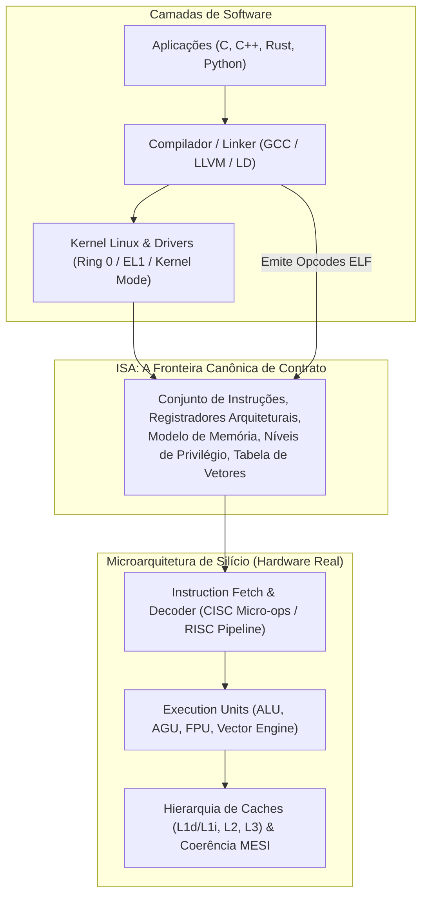

---

### 11.1 Conceito Fundamental de ISA e a Fronteira HW/SW

A **ISA** especifica *o que* o processador é capaz de fazer:
1.  **Formato de Codificação de Instruções:** Se as instruções possuem tamanho fixo (ex: 32 bits em ARM e MIPS) ou variável (1 a 15 bytes em x86).
2.  **Registradores Arquiteturais:** O conjunto visível ao programador/compilador (ex: `%rax..%r15` em x86_64, `x0..x31` em AArch64, `$0..$31` em MIPS).
3.  **Modelo de Memória e Consistência:**
    *   **TSO (Total Store Order - x86):** O hardware garante que as escritas na memória aparecem para todos os núcleos quase que rigorosamente na ordem em que foram emitidas pelo programa. Reordenações são raras (apenas *Store-Load* pode ser reordenado via *Store Buffers*).
    *   **Weak Memory Ordering (ARM e MIPS):** O processador tem total liberdade para reordenar leituras e escritas para maximizar o pipeline. O compilador ou o desenvolvedor de kernel deve injetar explicitamente barreiras de memória de hardware (`DMB`, `DSB`, `ISB` ou `SYNC`) para evitar condições de corrida em hardware multiprocessado (SMP).
4.  **Modelo de Privilégios:** A separação física entre código de usuário não-confiável e código de controle de hardware do Kernel:
    *   **x86:** Níveis de privilégio 0 a 3 (*Rings*), sendo Ring 0 o Kernel e Ring 3 a User-space.
    *   **ARMv8-A:** Níveis de exceção (*Exception Levels*), sendo EL0 (User), EL1 (Kernel OS), EL2 (Hypervisor) e EL3 (Secure Monitor / TrustZone).
    *   **MIPS:** Modos Kernel, Supervisor (opcional) e User.

---

### 11.2 ISA x86_64 (AMD64 / Intel 64)

O x86_64 é uma arquitetura **CISC (Complex Instruction Set Computer)** com conjunto de instruções de tamanho variável (de 1 byte até 15 bytes por instrução), suporte a operandos diretos em memória para a maioria das instruções aritméticas e suporte estrito a backward compatibility desde o 8086.

#### Tabela Canônica de Instruções ISA x86_64

| Mnemônico | Operandos Típicos | Classe de Operação | Descrição Técnica & Efeito Arquitetural |
| :--- | :--- | :--- | :--- |
| **`MOV`** | `dst, src` | Movimentação | Copia dados entre registradores, memória e constantes imediatas. Não afeta flags de status (`RFLAGS`). |
| **`LEA`** | `reg, [base + idx*scale + disp]` | Cálculo Aritmético | *Load Effective Address*: Calcula o endereço efetivo de memória e grava o resultado no registrador destino sem acessar a memória RAM e sem alterar flags. |
| **`PUSH` / `POP`** | `src` / `dst` | Gerenciamento de Pilha | Decrementa/incrementa o apontador de pilha `%rsp` por 8 bytes e grava/lê o valor no topo da pilha. |
| **`XCHG`** | `reg, reg/mem` | Atômica Implícita | Troca atomicamente o conteúdo de dois operandos. Quando um operando é de memória, o hardware aciona o prefixo `LOCK` automaticamente. |
| **`CMPXCHG`** | `dst_mem/reg, src_reg` | Sincronização / CAS | *Compare and Exchange*: Compara o acumulador `%rax` com `dst`. Se iguais, grava `src` em `dst` (Zero Flag `ZF=1`); se diferentes, carrega `dst` em `%rax` (`ZF=0`). |
| **`ADD` / `SUB`** | `dst, src` | Aritmética | Soma ou subtrai operandos (suporta memória direta: `addq $1, (%rdi)`). Atualiza flags `ZF`, `SF`, `OF`, `CF`. |
| **`IMUL` / `IDIV`**| `src` / `dst, src, imm` | Aritmética | Multiplicação e divisão com sinal. Em x86_64 de 64 bits, o par `%rdx:%rax` armazena o produto de 128 bits ou o dividendo/resto. |
| **`AND` / `OR` / `XOR`** | `dst, src` | Lógica Binária | Operações lógicas bit a bit. O idioma canônico para zerar um registrador gastando apenas 2 bytes de opcode é `xorl %eax, %eax`. |
| **`CMP` / `TEST`** | `op1, op2` | Comparação | `CMP` executa uma subtração interna `op1 - op2` e descarta o valor, apenas atualizando flags. `TEST` executa uma operação `AND` lógica apenas para atualizar flags de zero e sinal. |
| **`JMP` / `Jcc`** | `target` / `condition, target`| Controle de Fluxo | Desvio incondicional ou condicional baseado nas flags de `RFLAGS` (`JE`/`JZ`, `JNE`/`JNZ`, `JG`/`JL`, `JA`/`JB`). |
| **`CALL` / `RET`** | `target` / `[imm]` | Sub-rotinas | `CALL` empurra o `%rip` atual na pilha e salta para o destino. `RET` desempilha o endereço de retorno e carrega em `%rip`. |
| **`LOCK` (Prefix)**| *(Prefixo de instrução)* | Barramento Atômico | Transforma a instrução seguinte (`ADD`, `SUB`, `CMPXCHG`, `XADD`) em uma operação atômica multiprocessador via travamento de linha de cache (*Cache Lock*). |
| **`SYSCALL`** | *(Nenhum)* | Transição de Sistema | Transição atômica de Ring 3 (User) para Ring 0 (Kernel). Salva `%rip` em `%rcx` e `RFLAGS` em `%r11`, carregando o tratador do kernel a partir do MSR `IA32_LSTAR`. |
| **`SYSRET`** | *(Nenhum)* | Retorno de Kernel | Retorna de Ring 0 para Ring 3, restaurando `%rip` a partir de `%rcx` e flags a partir de `%r11`. |
| **`MFENCE` / `LFENCE`**| *(Nenhum)* | Barreira de Memória | *Memory / Load Fence*: Força a serialização de todas as leituras e escritas na memória pendentes nos *Store Buffers* da CPU. |
| **`PAUSE`** | *(Nenhum)* | Otimização de Pipeline | Melhora a performance de *spinlocks*, instruindo o processador a evitar quebras de pipeline por violação de ordem de memória durante loops de espera. |
| **`CPUID`** | *(Nenhum)* | Identificação HW | Retorna informações de arquitetura, fabricante (GenuineIntel/AuthenticAMD), extensões suportadas (AVX, SSE) e recursos nos registradores `%eax`, `%ebx`, `%ecx`, `%edx`. |
| **`VFMADD213PS`** | `ymm1, ymm2, ymm3` | Vetorial AVX2 SIMD | *Fused Multiply-Add*: Multiplica vetores de precisão simples em `ymm1` e `ymm2`, soma com `ymm3` e grava em `ymm1` com um único arredondamento e em um único ciclo de FPU. |

#### Dissecação de Instruções Críticas do x86_64

##### 1. A Mágica de Otimização da Instrução `LEA`
A instrução `LEA` (*Load Effective Address*) foi originalmente projetada no 8086 para calcular endereços de ponteiros de memória complexos para serem passados para outras rotinas. No entanto, os criadores de compiladores modernos (GCC e Clang) utilizam o `LEA` como uma unidade aritmética de alta velocidade para matemática pura:
```assembly
# Exemplo clássico em x86_64:
# Suponha que %rdi contém um inteiro X. Queremos calcular (X * 5) + 12:

leaq 12(%rdi, %rdi, 4), %rax   # %rax = %rdi + (%rdi * 4) + 12 = (X * 5) + 12
```
**Vantagens Arquiteturais:**
*   Executa uma multiplicação por 1, 2, 4 ou 8 somada a uma adição de registrador base e mais uma constante de deslocamento (offset) em **um único ciclo de clock** na AGU (*Address Generation Unit*).
*   **Não altera nenhuma flag do registrador `RFLAGS`**, permitindo que o compilador realize operações matemáticas sem destruir o resultado de comparações anteriores (`CMP`/`TEST`).

##### 2. O Mecanismo Atômico `LOCK CMPXCHG` (Compare-And-Swap)
É a base sobre a qual todos os spinlocks, mutexes do Kernel Linux e primitivas `std::atomic` do user-space são construídos:
```assembly
# Implementação de um Spinlock atômico em x86_64:
# %rdi aponta para o endereço do lock na memória. 0 = Livre, 1 = Ocupado.

tentar_lock:
    movl $0, %eax               # Valor esperado: 0 (livre)
    movl $1, %ecx               # Novo valor desejado: 1 (ocupado)
    lock cmpxchgl %ecx, (%rdi)  # Atômico: Se (%rdi) == %eax, então (%rdi) = %ecx (ZF=1)
    jnz esperar_lock            # Se ZF=0, outro core pegou o lock; desvia
    ret                         # Lock adquirido com sucesso!

esperar_lock:
    pause                       # Alivia o pipeline da CPU e reduz consumo térmico
    cmpl $0, (%rdi)             # Teste simples sem trancar o barramento de cache
    je tentar_lock              # Quando liberar, tenta o CAS atômico novamente
    jmp esperar_lock
```
O prefixo `LOCK` força o protocolo de coerência de cache (MESI ou MOESI) a transicionar a linha de cache correspondente ao endereço para o estado **Modified (Exclusive)**, impedindo que qualquer outro núcleo do processador leia ou escreva na mesma linha física durante a execução da instrução.

##### 3. A Revolução do `SYSCALL` vs. o Legado `INT 0x80`
No i386 tradicional de 32 bits, as chamadas de sistema eram feitas via interrupção de software:
```assembly
int $0x80                       # Modelo legado do Linux 32 bits
```
O `int 0x80` exige que a CPU consulte a IDT (*Interrupt Descriptor Table*) na RAM, salve registradores de segmento, alterne pilhas via TSS (*Task State Segment*) e verifique descritores de segurança. Esse processo consome centenas de ciclos de CPU.

No x86_64, a AMD introduziu a instrução direta **`SYSCALL`**:
*   A CPU não consulta tabelas na RAM.
*   O endereço de entrada do Kernel Linux já está previamente gravado no registrador de modelo específico da CPU **`MSR_LSTAR`** (`0xC0000082`).
*   A instrução simplesmente copia o `%rip` atual para `%rcx`, copia as flags para `%r11`, mascara as flags de interrupção com base no MSR `IA32_FMASK`, e salta instantaneamente para o código do kernel em Ring 0 gastando menos de 20 ciclos de clock.

---

### 11.3 ISA ARM (ARMv7-A 32-bit & AArch64 64-bit)

A arquitetura ARM é o padrão absoluto da computação móvel e de sistemas embarcados modernos. Ela é um processador **RISC (Reduced Instruction Set Computer)** estrito e segue o modelo de **Arquitetura Load-Store**:
> **Regra Fundamental RISC:** A unidade lógica e aritmética (ALU) opera **exclusivamente** sobre dados armazenados em registradores. **Nenhuma** instrução aritmética ou lógica tem acesso direto à memória RAM. Se você precisa somar um número na memória, é obrigatório carregá-lo em um registrador primeiro (`LDR`), executar a soma (`ADD`) e gravá-lo de volta (`STR`).

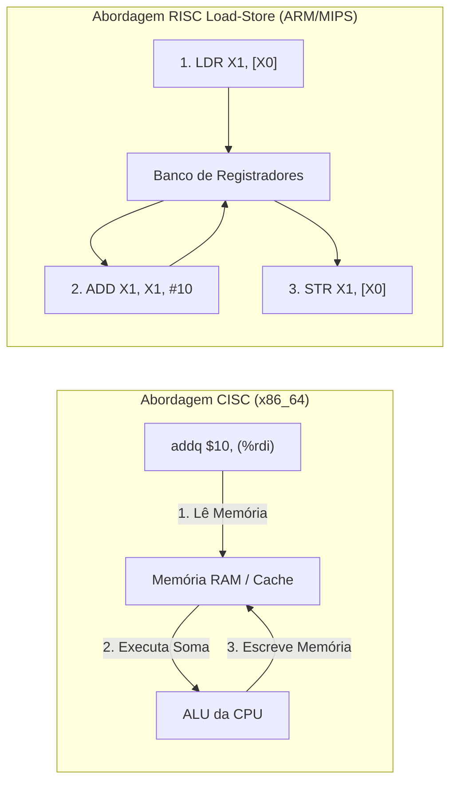

#### Tabela Canônica de Instruções ISA ARM (AArch64)

| Mnemônico | Operandos Típicos | Classe de Operação | Descrição Técnica & Efeito Arquitetural |
| :--- | :--- | :--- | :--- |
| **`LDR`** | `Xt, [Xn, #offset]` | Load | Carrega um dado de 64 bits da memória para o registrador `Xt`. |
| **`STR`** | `Xt, [Xn, #offset]` | Store | Grava o dado do registrador `Xt` na memória no endereço `Xn + offset`. |
| **`LDP` / `STP`** | `Xt1, Xt2, [Xn, #imm]!`| Load/Store Pair | Carrega ou grava **dois registradores de 64 bits contíguos** em uma única instrução de 32 bits. O sufixo `!` aplica pré-indexação com auto-incremento do ponteiro. |
| **`ADD` / `SUB`** | `Xd, Xn, Xm [, shift]` | Aritmética | Executa soma ou subtração com passagem opcional do operando `Xm` pelo *Barrel Shifter* sem custo de ciclos extras. |
| **`ADRP`** | `Xd, label` | Endereçamento PC-Rel | *Address of Page*: Carrega o endereço base da página de 4KB do rótulo relativo ao PC atual. Essencial para Position-Independent Code (PIC/PIE). |
| **`AND` / `ORR` / `EOR`** | `Xd, Xn, Xm` | Lógica | Operações binárias bit a bit em registradores. |
| **`B` / `B.cond`** | `label` / `cond, label` | Controle de Fluxo | Desvio incondicional ou condicional baseado no registrador de estado `PSTATE` (`B.EQ`, `B.NE`, `B.GT`, etc.). |
| **`BL`** | `target` | Chamada de Função | *Branch with Link*: Salta para a função e salva o endereço de retorno diretamente no registrador de link **`X30` (LR)**. |
| **`RET`** | `[Xn]` | Retorno de Sub-rotina | Desvia a execução para o endereço contido em um registrador (por padrão `X30` / LR). |
| **`CBZ` / `CBNZ`** | `Xt, label` | Desvio Otimizado | *Compare and Branch on Zero*: Compara se o registrador é zero e desvia em uma única instrução atômica, sem alterar flags no `PSTATE`. |
| **`LDXR` / `STXR`** | `Xt, [Xn]` / `Ws, Xt, [Xn]` | Exclusividade Atômica | *Load/Store Exclusive*: Primitiva LL/SC do ARM. O processador marca o endereço no *Exclusive Monitor*; o `STXR` só grava se nenhum outro núcleo modificou o endereço, retornando status em `Ws` (0 = sucesso). |
| **`SVC`** | `#imm` | Chamada de Sistema | *Supervisor Call*: Gera uma exceção síncrona para transicionar de EL0 (User) para EL1 (Kernel Linux). A syscall do Linux usa `SVC #0`. |
| **`DMB` / `DSB` / `ISB`**| `[op]` | Barreira de Memória | *Data Memory Barrier*, *Data Synchronization Barrier* e *Instruction Synchronization Barrier*. Força ordenação de acessos a periféricos e memória. |
| **`MSR` / `MRS`** | `sysreg, Xt` / `Xt, sysreg`| Registradores de Sistema| Move dados entre registradores de uso geral e registradores de controle do processador (`TTBR0_EL1`, `VBAR_EL1`, `SCTLR_EL1`). |

#### Dissecação de Recursos Avançados do ARM

##### 1. O Prólogo e Epílogo Ultracompacto com `STP` / `LDP`
Em processadores x86_64, a entrada e saída de funções exige múltiplos `push` e `pop`. Em AArch64, funções padrão salvam o Frame Pointer (`X29`) e o Link Register (`X30`) em um único ciclo através de `STP`:
```assembly
# Prólogo Canônico de Função em Linux AArch64:
minha_funcao:
    stp x29, x30, [sp, #-16]!   # Aloca 16 bytes na pilha e salva X29 e X30 simultaneamente!
    mov x29, sp                 # Atualiza o Frame Pointer para apontar para a nova base

    # ... corpo da função ...

# Epílogo Canônico de Saída:
    ldp x29, x30, [sp], #16     # Restaura X29 e X30 e desaloca a pilha com pós-indexação!
    ret                         # Retorna saltando diretamente para o endereço em X30
```

##### 2. O Barrel Shifter Embutido no Ciclo de Instrução
Uma das maiores inovações de silício da ARM é que a entrada do segundo operando da ALU passa fisicamente por uma unidade combinacional de deslocamento de bits (*Barrel Shifter*):
```assembly
# Calcula: X0 = X1 + (X2 << 3) em um único ciclo de clock!
add x0, x1, x2, lsl #3
```
Em outras arquiteturas, isso exigiria duas instruções separadas (`SHL` seguido de `ADD`).

##### 3. A Primitiva de Sincronização `LDXR` / `STXR`
Diferente do x86 que tranca o barramento com o prefixo `LOCK`, o ARM utiliza o modelo **Load-Linked / Store-Conditional**:
```assembly
spinlock_arm:
    mov w2, #1                  # Valor de lock ocupado
1:
    ldxr w1, [x0]               # Lê o valor atual e arma o Exclusive Monitor no endereço
    cbnz w1, 1b                 # Se w1 != 0 (lock ocupado), tenta de novo
    stxr w3, w2, [x0]           # Tenta gravar 1. Se ninguém mexeu, w3 = 0; se falhou, w3 = 1
    cbnz w3, 1b                 # Se falhou a exclusividade, reinicia o loop
    dmb ish                     # Barreira de memória: garante que leituras e escritas futuras
                                # não passem para antes do lock
```

---

### 11.4 ISA MIPS (MIPS32 & MIPS64)

Criada pelos professores John Hennessy (Stanford) e David Patterson (Berkeley), a arquitetura MIPS (*Microprocessor without Interlocked Pipeline Stages*) é a encarnação mais pura dos princípios acadêmicos de RISC. Ela fundamentou os roteadores domésticos (OpenWrt/Buildroot) e servidores industriais legados.

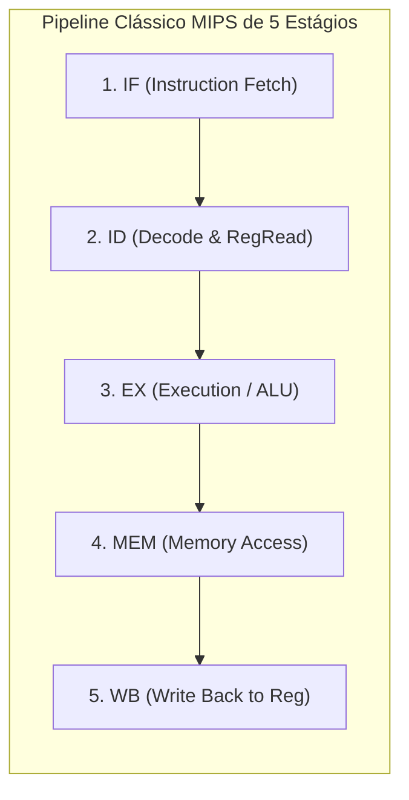

#### Tabela Canônica de Instruções ISA MIPS

| Mnemônico | Operandos Típicos | Classe de Operação | Descrição Técnica & Efeito Arquitetural |
| :--- | :--- | :--- | :--- |
| **`lw` / `sw`** | `$t0, offset($s0)` | Load / Store Word | Carrega ou grava uma palavra de 32 bits da memória. Exige alinhamento estrito a múltiplos de 4 bytes. |
| **`lui`** | `$t0, 0x1234` | Carga Imediata | *Load Upper Immediate*: Carrega a constante de 16 bits na metade superior (bits 16..31) do registrador destino, zerando a parte baixa. |
| **`add` / `addu`**| `$d, $s, $t` | Aritmética 3-Operandos | `$d = $s + $t`. `add` gera uma exceção de hardware de *Overflow* se estourar o sinal; `addu` (Unsigned) não gera exceção. O Linux utiliza quase exclusivamente `addu`. |
| **`and` / `or` / `nor`** | `$d, $s, $t` | Lógica Binária | Operações lógicas. O MIPS inclui a instrução **`nor`**, que permite implementar inversão lógica de bits (*NOT*) fazendo `$d = NOR($s, $zero)`. |
| **`sll` / `srl`** | `$d, $t, shamt` | Deslocamento de Bits | *Shift Left/Right Logical*: Desloca bits por um valor constante imediato (*Shift Amount*). |
| **`beq` / `bne`** | `$s, $t, label` | Desvio Condicional | *Branch if Equal / Not Equal*: Compara dois registradores diretamente e salta se a condição for satisfeita. |
| **`j` / `jal`** | `target` | Salto Incondicional | `j` salta para um endereço absoluto de 26 bits. `jal` (*Jump and Link*) salta e salva o endereço de retorno no registrador `$31` (`$ra`). |
| **`jr`** | `$ra` | Salto por Registrador | Salta para o endereço armazenado no registrador especificado (instrução padrão de retorno de funções em MIPS: `jr $ra`). |
| **`ll` / `sc`** | `$t0, ($s0)` | Atômica Hardware | *Load Linked / Store Conditional*: A primitiva de sincronização do MIPS equivalente ao LDXR/STXR do ARM. |
| **`syscall`** | *(Nenhum)* | Chamada de Sistema | Gera uma exceção de trap do sistema operacional. O número da syscall no Linux MIPS é passado no registrador `$v0`. |
| **`mfc0` / `mtc0`**| `$t0, $cop0_reg` | Controle de Sistema | *Move From/To Coprocessor 0*: Acessa registradores internos de gerenciamento de MMU, TLB e interrupções do chip. |
| **`nop`** | *(Nenhum)* | Sem Operação | Codificada fisicamente como `sll $0, $0, 0`. Utilizada maciçamente para preencher *Delay Slots*. |

#### Peculiaridades Fundamentais da Arquitetura MIPS

##### 1. O infame *Branch Delay Slot*
No design original do MIPS, os criadores queriam eliminar circuitos complexos de intertravamento de pipeline (*hardware interlocks*). Por isso, o hardware começa a buscar e executar a instrução seguinte **antes** de o salto do branch terminar de processar!
> **Regra de Ouro do MIPS:** A instrução localizada imediatamente abaixo de um branch ou jump **é SEMPRE executada**, quer o desvio seja tomado ou não!

```assembly
# Exemplo de código MIPS compilado:
    bne $s0, $s1, target_label
    addiu $t0, $t0, 1           # <-- ESTA INSTRUÇÃO NO DELAY SLOT É EXECUTADA ANTES DO SALTO!
```
Se o compilador não tiver nenhuma instrução útil para mover para o delay slot, ele é obrigado a inserir explicitamente um **`nop`**:
```assembly
    jal calcula_hash
    nop                         # Gasta 4 bytes para evitar execução errática no delay slot
```

##### 2. O Papel Sagrado do Registrador `$zero` (`$0`)
No MIPS, o registrador `$0` é fisicamente aterrado ao terra (*hardwired to 0*). Qualquer leitura de `$0` retorna sempre o número zero, e qualquer escrita em `$0` é silenciosamente descartada pelo silício.
Isso permitiu aos engenheiros eliminar dezenas de instruções da CPU, criando pseudo-instruções equivalentes:
*   Copiar registrador (`move $d, $s`) é sintetizado como: `addu $d, $s, $zero`
*   Inverter bits (`not $d, $s`) é sintetizado como: `nor $d, $s, $zero`
*   Limpar registrador (`clear $d`) é sintetizado como: `addu $d, $zero, $zero`

##### 3. O Coprocessador 0 (CP0) e o Tratador de Falhas de Página
Diferente de x86 e ARM, onde o processador percorre as tabelas de páginas de memória (*Page Tables*) automaticamente via hardware (*Hardware Page Table Walker*), no MIPS tradicional a tradução de memória virtual via **TLB é controlada por software**:
Quando ocorre um *TLB Miss* (falha de página), a CPU MIPS dispara uma exceção para o registrador CP0 `EPC`, salta para um tratador em assembly no kernel, que lê os registradores `BadVAddr` e `EntryHi`, consulta a tabela de páginas em memória RAM e grava a nova tradução diretamente no TLB usando a instrução `tlbwi` (*TLB Write Indexed*)!

---

### 11.5 Arquiteturas Legadas e Históricas

Para compreender as idiossincrasias modernas do Kernel Linux e as convenções que perduram até hoje no código-fonte, é indispensável conhecer os três grandes marcos históricos da computação que moldaram os processadores atuais.

#### 1. Intel 8086 e 8088 (16-bit, 1978 / 1979)

*   **O Contexto:** O 8086 foi o patriarca de toda a família x86. O processador 8088 era idêntico internamente ao 8086 (ambos possuíam registradores de 16 bits), mas possuía um barramento de dados externo de apenas 8 bits. Isso permitiu à IBM baratear os circuitos da placa-mãe e lançar o **IBM PC 5150** em 1981, consagrando a arquitetura para sempre.
*   **O Limite de 1 MB e a Aritmética de Segmentos:**
    O 8086 possuía 20 pinos físicos de endereço ($2^{20} = 1.048.576\text{ bytes} = 1\text{ MB}$). Como os registradores tinham apenas 16 bits (capazes de endereçar no máximo 64 KB diretamente), a Intel inventou o **Modelo de Memória Segmentada**:
    $$\text{Endereço Físico} = (\text{Segmento} \times 16) + \text{Offset} = (\text{Segmento} \ll 4) + \text{Offset}$$
    *Exemplo Prático:* O ponteiro lógico `0x1000:0x0250` aponta para:
    $$(0x1000 \times 16) + 0x0250 = 0x10000 + 0x0250 = 0x10250\text{ (na memória física)}$$
*   **A Ausência Total de Proteção de Memória:**
    No 8086/8088, o processador opera exclusivamente no que hoje chamamos de **Modo Real (Real Mode)**:
    *   Não existem anéis de privilégio (*rings*). Todo código tem acesso irrestrito ao hardware.
    *   Não existe memória virtual nem paginação. Qualquer ponteiro corrompido em uma aplicação sobrescreve a tabela de vetores de interrupção (IVT) no endereço `0x00000` ou até mesmo o código do sistema operacional (MS-DOS).

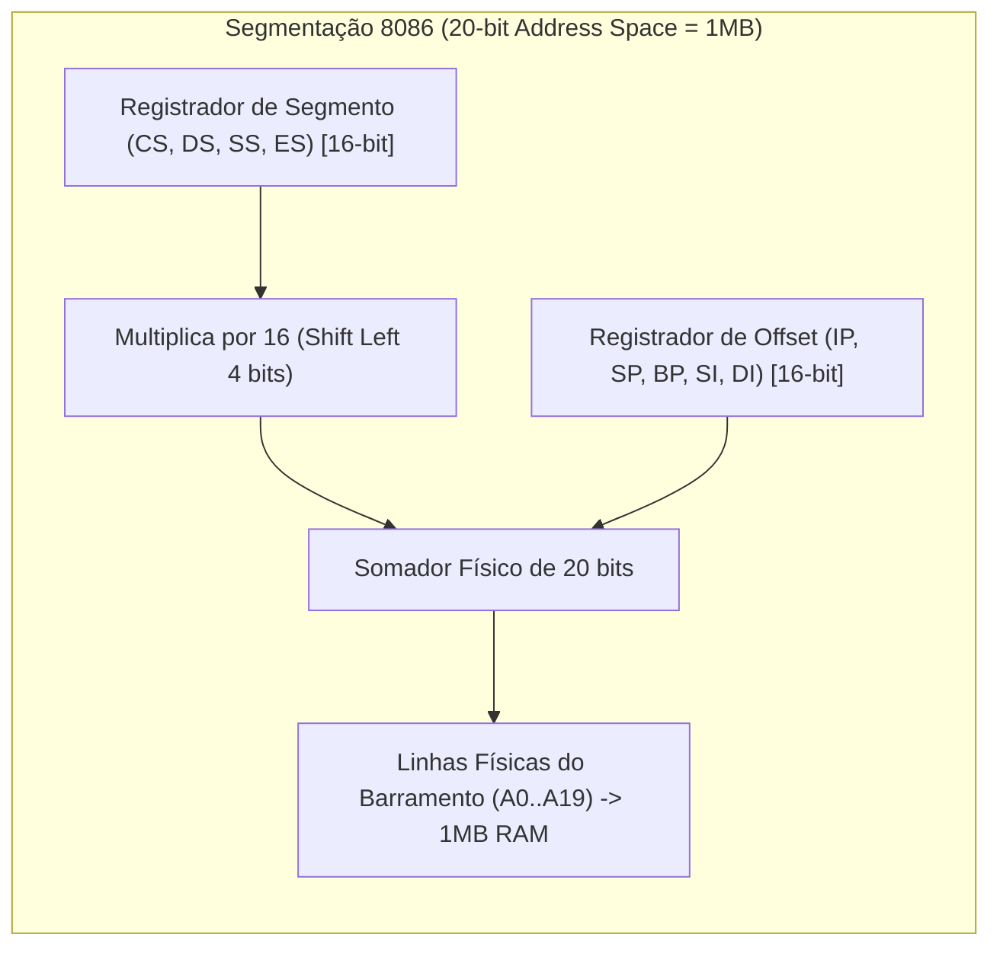

---

#### 2. Intel 80286 (i286 16-bit, 1982)

*   **O Nascimento do Modo Protegido (Protected Mode):**
    O 286 introduziu a capacidade de isolar processos e proteger o sistema operacional contra aplicações instáveis, expandindo o barramento de endereços para **24 bits** ($2^{24} = 16\text{ MB}$ de memória RAM física) e até 1 GB de espaço de endereçamento virtual.
*   **A Metamorfose dos Registradores de Segmento:**
    No 286, quando o bit PE (*Protection Enable*) da palavra de estado da máquina (MSW) é ativado, os registradores de segmento (`CS`, `DS`, `SS`, `ES`) deixam de ser ponteiros matemáticos multiplicados por 16 e tornam-se **Seletores de Segmento**:
    *   O seletor aponta para uma entrada em uma tabela na RAM chamada **GDT (Global Descriptor Table)** ou **LDT (Local Descriptor Table)**.
    *   Cada descritor da GDT define: Endereço Base (24 bits), Limite de Tamanho do Segmento (16 bits) e **Direitos de Acesso / Nível de Privilégio (DPL - Descriptor Privilege Level de 0 a 3)**.
*   **A Grande Falha Arquitetural do i286:**
    A Intel cometeu um erro de design crítico: **O 286 possuía instruções para entrar no Modo Protegido, mas não possuía NENHUMA instrução para sair dele e retornar ao Modo Real!**
    *   Como na época o ecossistema mundial rodava em MS-DOS (que operava exclusivamente em Modo Real), rodar softwares DOS após chavear para o modo protegido exigia uma gambiarra de engenharia grotesca criada pela IBM:
    *   O software gravava um vetor de retorno na memória volátil CMOS, programava o microcontrolador Intel 8042 (o chip do teclado da placa-mãe!) para puxar a linha física de `RESET` da CPU e forçava uma reinicialização de hardware do processador para que ele voltasse em Modo Real, continuando a execução do ponto salvo!
    *   Essa limitação bizarra só foi consertada em definitivo em 1985 com o lançamento do lendário **Intel 80386**, que trouxe registradores de 32 bits, suporte a paginação de memória e a capacidade de chavear livremente entre Modo Real e Modo Protegido via instruções de software.

---

#### 3. SPARC (Scalable Processor Architecture - Sun Microsystems / ESA)

Nascida em 1987 a partir dos laboratórios da Sun Microsystems e inspirada no projeto RISC I & II de Berkeley, a arquitetura SPARC dominou servidores corporativos e estações de trabalho de missão crítica UNIX (Solaris) nas décadas de 1990 e 2000.

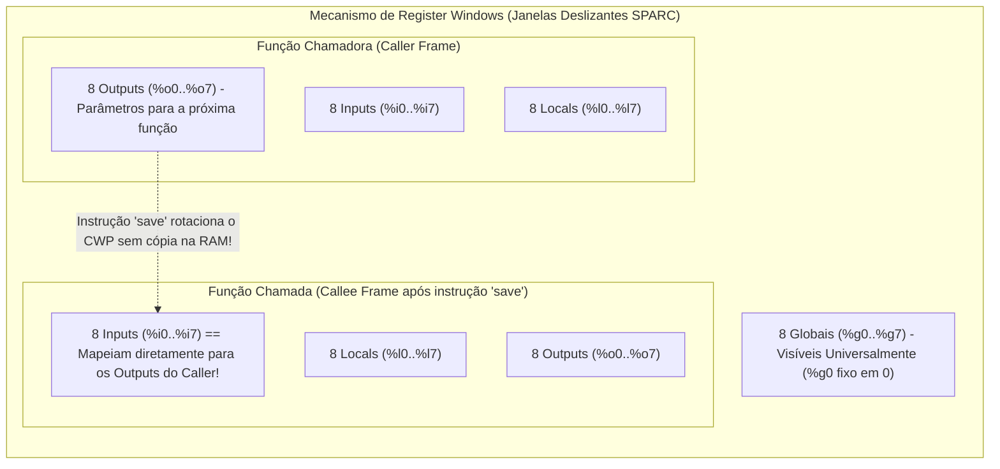

##### O Conceito Revolucionário de *Register Windows* (Janelas de Registradores)
Enquanto a maioria das CPUs possui um número pequeno de registradores fixos e gasta ciclos salvando dados na pilha (stack) na memória RAM em cada chamada de função, o SPARC possui um banco físico gigantesco (de 128 a mais de 500 registradores físicos no silício).
A aplicação enxerga apenas uma janela deslizante de **32 registradores lógicos** por vez:
1.  **`%g0..%g7` (8 Registradores Globais):** Acessíveis por todas as rotinas em qualquer momento (`%g0` é sempre 0, como no MIPS).
2.  **`%i0..%i7` (8 Registradores de Entrada / In):** Recebem os parâmetros passados pela função que a chamou.
3.  **`%l0..%l7` (8 Registradores Locais):** Variáveis locais da função atual.
4.  **`%o0..%o7` (8 Registradores de Saída / Out):** Utilizados para preparar os parâmetros que serão passados para a próxima sub-rotina.

##### As Instruções `save` e `restore`
Ao chamar uma função com `call`, o desenvolvedor executa a instrução **`save`**:
*   A CPU rotaciona o ponteiro da janela atual (**CWP - Current Window Pointer**).
*   Os antigos registradores de saída (`%o0..%o7`) da função chamadora passam a ser **instantaneamente os registradores de entrada (`%i0..%i7`) da função chamada**!
*   **Resultado de Engenharia:** A passagem de parâmetros e o isolamento de variáveis locais ocorrem com **custo zero de acesso à memória RAM**, eliminando totalmente os tradicionais gargalos de prólogos e epílogos de funções.

##### Tratamento de *Window Overflow* e *Window Underflow*
Como o número de janelas no chip físico é finito (tipicamente 8 janelas de registradores em anel circular):
*   Se o programa aninhar mais chamadas de função do que o hardware suporta, o anel colide e a CPU dispara uma interrupção de hardware por trap chamada **Window Overflow**.
*   O Kernel do sistema operacional intercepta a trap e descarrega a janela mais antiga na pilha na memória RAM.
*   Ao retornar (`restore`), caso a janela requisitada esteja salva na RAM, o processador dispara uma trap de **Window Underflow** e o kernel recarrega os dados de volta para o silício.

##### A Sobrevivência do SPARC no Setor Aeroespacial: O Processador LEON
Embora tenha sido superado por x86_64 e ARM em servidores comerciais, o SPARC vive como o padrão supremo em computação espacial.
A **Agência Espacial Europeia (ESA)** desenvolveu e mantém os núcleos **LEON3** e **LEON4**, que são implementações limpas e sintetizáveis em VHDL da arquitetura SPARC V8.
*   **Por que o SPARC foi escolhido para o espaço?**
    *   A simplicidade da ISA permitiu a implementação de tolerância a radiação extrema (*Radiation-Hardening*).
    *   Uso de técnicas de **TMR (Triple Modular Redundancy)**: cada flip-flop no chip é triplicado e possui um circuito de votação por maioria. Se um raio cósmico (SEU - *Single Event Upset*) inverter um bit no registrador, os outros dois corrigem o dado em tempo real sem causar pane no satélite ou na sonda interplanetária.
    *   O Kernel Linux oficial e o Buildroot mantêm suporte ativo à arquitetura SPARC/LEON para operação em missões orbitais.

---
*Documento consolidado como Especificação Técnica Canônica do WitchcraftFEX / BloodmoonOS.*

