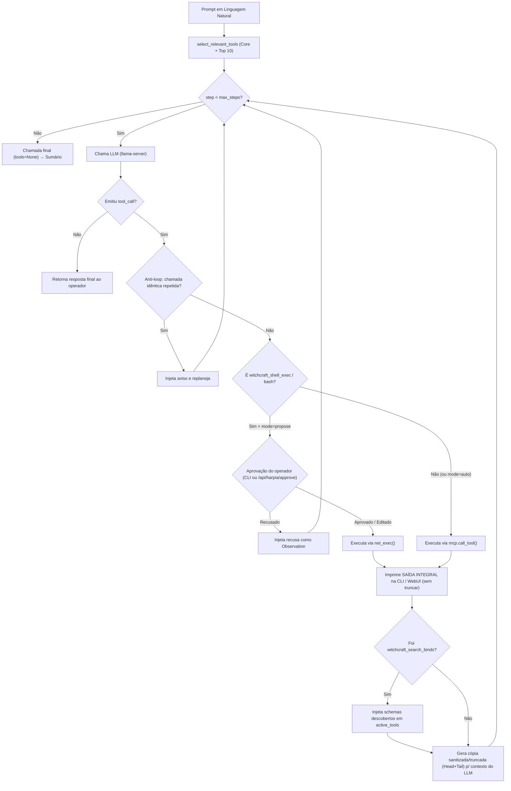

# Harpia AI — Modo Agentic, Encadeamento MCP e Shell Puro

> **Subsistema**: `witchcraft/interface/ai/`, `witchcraft/interface/mcp/`, `witchcraft/interface/cli/`, `spellbook/pkg/server/`  
> **Padrão de Execução**: Loop ReAct Multi-Step com Injeção Dinâmica de Tools MCP e Aprovação Human-in-the-Loop para Shell Puro

---

## 1. Visão Geral

O **Harpia AI** opera como um agente autônomo em loop (*ReAct*: `Thought → Action → Observation`), permitindo que o operador emita instruções em **linguagem natural** e delegue ao agente o encadeamento de múltiplos comandos MCP até concluir a tarefa.

Quando nenhuma bind declarativa do `rocketdb_v2.json` cobre o que precisa ser feito (ex.: pipelines com `grep`/`awk`, inspeções ad-hoc de rede/arquivos ou encadeamentos `&&`), o agente é capaz de **propor comandos em modo SHELL puro** (`witchcraft_shell_exec`) sujeitos à política de aprovação configurada pelo operador.

---

## 2. Arquitetura do Loop ReAct (`harpia_agent.py`)



### Garantias Principais

1. **Encadeamento Real Multi-Step**:
   - Controlado por `max_steps` (padrão `8`, ajustável via `NT_HARPIA_MAX_STEPS` ou `/steps <N>`).
   - O loop só encerra quando o LLM produz uma resposta final sem `tool_call` ou atinge `max_steps`.
2. **Injeção Dinâmica de Ferramentas (`_inject_discovered_tools`)**:
   - Para não estourar a janela de contexto de modelos locais (3B–8B), o agente inicia com as tools core (`witchcraft_search_binds`, `witchcraft_system_stats`, `witchcraft_xcript_eval`, `witchcraft_shell_exec`) + top 10 por relevância lexical.
   - Sempre que o agente executa `witchcraft_search_binds`, os schemas reais (`inputSchema`) das binds encontradas são injetados dinamicamente em `active_tools` (até 20 tools ativas) e o `system` message é atualizado para o próximo passo.
3. **Parser Multi-Chamada Robusto (`_extract_inline_tool_calls`)**:
   - Suporta `tool_calls` nativos da API OpenAI (`llama-server --jinja`) e múltiplos blocos `<tool_call>{...}</tool_call>` na mesma resposta usando `json.JSONDecoder().raw_decode()`, suportando JSON aninhado sem quebrar.
4. **Proteção Anti-Loop**:
   - Cada chamada é indexada por `(tool_name, canonical_json_args)` em `seen_calls`. Se o modelo repetir exatamente a mesma chamada, recebe um aviso no contexto para usar a observação anterior ou mudar de estratégia.

---

## 3. Política de Saída: Output Integral vs Sumário Truncado

Esta é uma regra estrita da arquitetura do Harpia:

- **Operador (CLI e WebUI) — 100% Integral (Sem Truncamento)**:
  - Na CLI (`witchcraft/witchcraft/interface/cli/interactive.py`), cada ferramenta executada dispara imediatamente o callback `on_tool_output(record)` imprimindo todo o `stdout` e `stderr` completos no terminal.
  - Na WebUI (`witchcraft/spellbook/webui/index.html`), `tool_calls[].output` sempre carrega o output completo de cada passo sem cortes.
- **LLM (Raciocínio e Sumário) — Truncado apenas no contexto interno**:
  - Apenas a cópia injetada em `messages` via `_format_output_for_llm()` remove tags HTML e aplica truncamento **Head + Tail** (`1000` caracteres iniciais + `1000` finais) quando a saída excede o limite, evitando overflow de contexto durante o raciocínio e a geração do sumário final.

---

## 4. Modo "SHELL Puro" (`witchcraft_shell_exec`)

Adicionada a ferramenta nativa `witchcraft_shell_exec` em `witchcraft/witchcraft/interface/mcp/mcp_server.py`:

- **Schema**:
  - `command` (obrigatório): linha de comando shell arbitrária (suporta pipes `|`, redirecionamentos, `&&`, `awk`, `grep`, etc.).
  - `reason` (opcional): justificativa do agente explicando por que o shell puro foi proposto.
- **Respeito ao Metalcore**: valida `NT_ENABLE_ARBITRARY_SHELL=True` antes de invocar `net_exec()`.

### Políticas de `shell_mode`

| Modo | Comportamento |
| :--- | :--- |
| `propose` (padrão) | O agente propõe o comando e o motivo; a execução pausa aguardando aprovação do operador (com opção de aprovar, editar o comando ou recusar). |
| `auto` | Executa comandos `witchcraft_shell_exec` diretamente sem pedir confirmação interativa (recomendado apenas em laboratórios isolados). |
| `off` | Bloqueia execução de shell puro e força o agente a operar exclusivamente com binds MCP do `rocketdb_v2.json`. |

---

## 5. Operação na CLI (`harpia.cli` e `harpia.ask`)

Inicie o REPL interativo:

```bash
./main.py harpia.cli
```

### Comandos do REPL

| Comando | Ação |
| :--- | :--- |
| `<texto livre>` | Executa o loop agêntico ReAct em linguagem natural. |
| `/mode agent` ou `/mode propose` | Modo agente com aprovação interativa para shell puro (`[y/N/e]`). |
| `/mode auto` | Modo agente com execução automática de shell puro. |
| `/mode off` | Modo agente restrito a binds MCP (sem shell puro). |
| `/mode shell` | Entra em modo **SHELL PURO direto** (`shell> `), executando cada linha no shell até voltar com `/mode agent`. |
| `/steps <N>` | Ajusta o número máximo de passos do loop ReAct no turno. |
| `/shell <cmd>` ou `!<cmd>` | Executa um comando shell puro pontual imediatamente (mesmo com LLM offline). |
| `/mcp <tool> <json>` | Invoca uma ferramenta MCP diretamente. |
| `/xcript <code>` | Executa código Xcript diretamente. |
| `/clear` | Limpa o histórico da conversa. |
| `exit` / `quit` | Encerra o REPL. |

### Execução One-Shot (`harpia.ask`)

```bash
./main.py harpia.ask --prompt "busque binds de dns e verifique example.com" --shell_mode propose --max_steps 6
```

---

## 6. API HTTP & Integração WebUI (`server.py` + `webui/index.html`)

O servidor HTTP (`witchcraft/spellbook/pkg/server/server.py`) expõe endpoints puramente JSON (sem HTML no backend):

### `POST /api/harpia/chat`

```json
{
  "prompt": "verifique portas abertas localmente com ss e resuma",
  "history": [],
  "shell_mode": "propose",
  "max_steps": 8,
  "ztoken": "<token>"
}
```

- **Resposta concluída (`status: "ok"`)**: retorna `reply`, `steps` e `tool_calls` (com `output` integral de cada passo).
- **Resposta pausada para aprovação (`status: "awaiting_approval"`)**:

```json
{
  "status": "awaiting_approval",
  "session_id": "a1b2c3d4...",
  "pending_action": {
    "tool": "witchcraft_shell_exec",
    "command": "ss -tulpn | grep LISTEN",
    "reason": "List listening sockets with pipe filter"
  },
  "reply": "Awaiting operator approval to execute raw shell command:\nss -tulpn | grep LISTEN",
  "tool_calls": [],
  "steps": 0
}
```

### `POST /api/harpia/approve`

Retoma a sessão pausada aprovando (com edição opcional) ou recusando o comando proposto:

```json
{
  "session_id": "a1b2c3d4...",
  "approved": true,
  "edited_command": "ss -tulpn",
  "ztoken": "<token>"
}
```

Na WebUI (`㊊ Harpia`), quando `status === "awaiting_approval"`, um cartão amarelo `[SHELL PROPOSTO]` é renderizado com o campo editável do comando e botões **Executar** e **Recusar**, retomando o loop automaticamente após a decisão.

---

## 7. Variáveis de Ambiente

| Variável | Padrão | Descrição |
| :--- | :--- | :--- |
| `NT_HARPIA_URL` | `http://localhost:5599/v1/chat/completions` | Endpoint OpenAI-compatible do `llama-server`. |
| `NT_HARPIA_MAX_STEPS` | `8` | Limite padrão de passos por turno no loop ReAct. |
| `NT_HARPIA_SHELL_MODE` | `propose` | Política padrão de shell puro (`propose`, `auto`, `off`). |
| `NT_ENABLE_ARBITRARY_SHELL` | `True` | Chave mestra do Metalcore para permitir execução shell arbitrária. |
