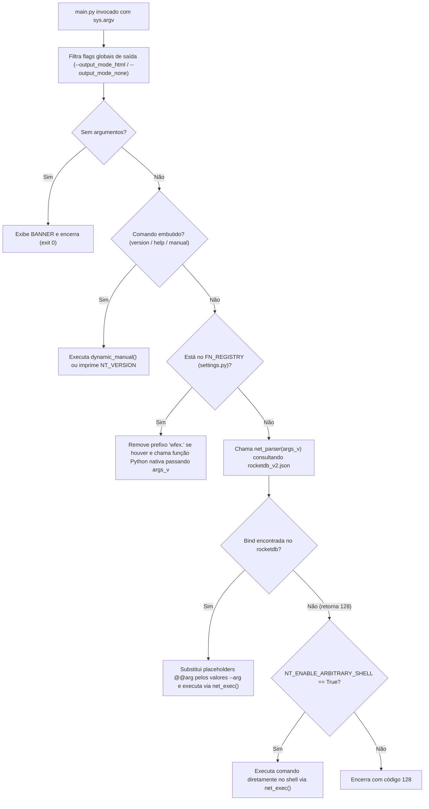

# 🛠️ WitchcraftFEX — Documentação Técnica de Código & Guia de Operações no Dia a Dia

> **Documento Técnico Oficial — Engenharia Interna, Subsistema Harpia (AI/MCP/CLI/Web), Linguagem Xcript e Playbooks Operacionais**  
> **Ecossistema:** Witchcraft Monorepo (`witchcraft/`, `xcript/`, `bloodmoon-os/`, `documentation/`)

---

## Sumário

1. [Visão Geral da Arquitetura do Monorepo](#1-visão-geral-da-arquitetura-do-monorepo)
2. [Engenharia de Código do WitchcraftFEX (`witchcraft/`)](#2-engenharia-de-código-do-witchcraftfex-witchcraft)
   - [2.1 Fluxo de Execução e Roteamento (`main.py` e `metalcore/core.py`)](#21-fluxo-de-execução-e-roteamento-mainpy-e-metalcorecorepy)
   - [2.2 Variáveis de Ambiente e Modos de Renderização](#22-variáveis-de-ambiente-e-modos-de-renderização)
   - [2.3 O Banco Declarativo `rocketdb_v2.json` e o Campo `cmd_backend`](#23-o-banco-declarativo-rocketdb_v2json-e-o-campo-cmd_backend)
   - [2.4 Subsistema `witchcraft/interface/` (Harpia: `ai`, `cli`, `mcp`, `web`)](#24-subsistema-witchcraftinterface-harpia-ai-cli-mcp-web)
   - [2.5 Servidor HTTP Multi-Thread e Autenticação HMAC (`spellbook/pkg/server/server.py`)](#25-servidor-http-multi-thread-e-autenticação-hmac-spellbookpkgserverserverpy)
   - [2.6 Módulos Nativos (`witchcraft/modules/`)](#26-módulos-nativos-witchcraftmodules)
3. [Engenharia da Linguagem Witchcraft-Xcript (`xcript/`)](#3-engenharia-da-linguagem-witchcraft-xcript-xcript)
   - [3.1 Arquitetura do Interpretador Estático em Rust](#31-arquitetura-do-interpretador-estático-em-rust)
   - [3.2 O Tipo Dinâmico `Omega` (`src/omega.rs`)](#32-o-tipo-dinâmico-omega-srcomegars)
   - [3.3 Referência Completa de Sintaxe Xcript (`scr/define.config`)](#33-referência-completa-de-sintaxe-xcript-scrdefineconfig)
4. [Guia de Extensibilidade (Como Criar Módulos, Binds e Extensões)](#4-guia-de-extensibilidade-como-criar-módulos-binds-e-extensões)
5. [Manual de Usabilidade no Dia a Dia (Operações Práticas)](#5-manual-de-usabilidade-no-dia-a-dia-operações-práticas)
   - [5.1 Preparação Rápida do Ambiente](#51-preparação-rápida-do-ambiente)
   - [5.2 Operando via CLI no Dia a Dia](#52-operando-via-cli-no-dia-a-dia)
   - [5.3 Operando via WebUI (`server.default` e `server.minimal`)](#53-operando-via-webui-serverdefault-e-serverminimal)
   - [5.4 Usando o Agente Harpia (Chat Web, CLI Interativa e IA Local)](#54-usando-o-agente-harpia-chat-web-cli-interativa-e-ia-local)
   - [5.5 Conectando o Witchcraft MCP a Agentes Externos](#55-conectando-o-witchcraft-mcp-a-agentes-externos)
   - [5.6 Playbooks Reais por Cenário (Recon, Web, Forense, Infra, Automação Xcript)](#56-playbooks-reais-por-cenário-recon-web-forense-infra-automação-xcript)

---

## 1. Visão Geral da Arquitetura do Monorepo

O repositório **Witchcraft** é organizado como um monorepo enxuto, projetado para rodar sem dependências externas de terceiros (`pip` / `crates.io` desnecessários), garantindo portabilidade máxima em ambientes restritos, containers ou cyberdecks:

```text
witchcraft_fex/
├── witchcraft/                  # Suite principal WitchcraftFEX (Python 3 stdlib + binários em spellbook/)
│   ├── main.py                  # Ponto de entrada universal da CLI
│   ├── witchcraft/
│   │   ├── settings.py          # Registro central de funções nativas (FN_REGISTRY)
│   │   ├── metalcore/
│   │   │   └── core.py          # Kernel de execução, logger ANSI/HTML, parser de binds e roteador
│   │   ├── interface/           # Camada de interfaces e ecossistema Harpia
│   │   │   ├── ai/              # Agente Harpia (integração LLM local <-> MCP)
│   │   │   ├── cli/             # REPL interativo de terminal (harpia.cli)
│   │   │   ├── mcp/             # Servidor Model Context Protocol (JSON-RPC 2.0 stdio)
│   │   │   └── web/             # Gerador SPA HTMX, templates e extensões (Home, Harpia, Haki, etc.)
│   │   ├── modules/             # Módulos operacionais nativos (scanner, osint, system, server, genreport)
│   │   └── tests/               # Suíte de testes automatizados (unittest)
│   └── spellbook/               # Grimório de dados, banco rocketdb_v2.json, servidor HTTP, llama.cpp e wordlists
├── xcript/                      # Interpretador estático em Rust da linguagem Witchcraft-Xcript
│   ├── Cargo.toml               # Configuração de build estático (LTO, strip, panic=abort)
│   ├── .cargo/config.toml       # Flags +crt-static
│   ├── scr/define.config        # Especificação formal da linguagem Xcript
│   └── src/                     # Código-fonte Rust (omega.rs, lexer.rs, parser.rs, interpreter.rs, main.rs)
├── bloodmoon-os/                # Sistema operacional minimalista baseado em Buildroot para cyberdecks
├── documentation/               # Wiki Docsify, diagramas Mermaid e changelogs
└── manifest/                    # Manifestos e textos conceituais Cypherpunk
```

---

## 2. Engenharia de Código do WitchcraftFEX (`witchcraft/`)

### 2.1 Fluxo de Execução e Roteamento (`main.py` e `metalcore/core.py`)

Toda execução no WitchcraftFEX começa em `witchcraft/main.py`:

```python
from witchcraft.metalcore.core import net_shell_router
from witchcraft.settings import *

net_shell_router(FN_REGISTRY)
```

O ciclo de vida dentro de `net_shell_router(fn_registry, script_path)` segue **5 estágios determinísticos**:



#### Funções Fundamentais do `metalcore/core.py`
| Função | Assinatura | Responsabilidade Técnica |
| :--- | :--- | :--- |
| `net_logger` | `net_logger(text, color="white", style="normal", newline=False)` | Formata cada linha de `text` usando a paleta `COLORS` (ANSI), `COLORS_HTML` (`<span>`) ou texto puro (`none`). Se `NT_ENABLE_LOGGER=True`, grava em `$NT_DATAROOT/logs/net.log`. |
| `net_exec` | `net_exec(command: str) -> dict` | Executa subprocesso via `subprocess.Popen(..., shell=True)`, capturando e retornando `{"stdout": str, "stderr": str, "status": int}`. |
| `search_arg` | `search_arg(args: list, keyword: str, enforce_keyword=True)` | Percorre a lista `args` procurando `--<keyword>` e retorna o token imediatamente seguinte. Se `enforce_keyword=True` e a flag não for informada, exibe erro padronizado e encerra com `sys.exit(128)`. |
| `read_db` | `read_db() -> list` | Carrega `$NT_DATAROOT/database/rocketdb_v2.json` e retorna a lista contida na chave `"index"`. |
| `net_parser` | `net_parser(args_v: list) -> int` | Procura `args_v[0]` em `read_db()`. Para cada argumento declarado no bind, busca `--<arg>` via `search_arg` e substitui `@@<arg>` na string `command`, executando o resultado com `net_exec`. |
| `raw_requests` | `raw_requests(url, method, protocol, authorization, body, data, save)` | Construtor nativo de requisições HTTP/HTTPS sobre `curl` sem bibliotecas externas. |
| `chrome` | `chrome(url, mode, window_size) -> dict` | Controla Chromium headless (`--headless=new`) para extrair `dom`, gerar `pdf` ou capturar `screenshot`. |

---

### 2.2 Variáveis de Ambiente e Modos de Renderização

O comportamento do kernel `metalcore` é controlado por variáveis de ambiente lidas na inicialização:

| Variável | Valor Padrão | Descrição |
| :--- | :--- | :--- |
| `NT_DATAROOT` | `"spellbook/"` | Caminho base para o diretório `spellbook/` (deve terminar com `/`). |
| `NT_SETUP_COLORS` | `"color"` | Modo de saída: `"color"` (ANSI), `"html"` (`<span>` para WebUI) ou `"none"` (texto puro para logs/MCP). |
| `NT_DEBUG` | `None` | Quando `True`, `net_exec` imprime comando, `stdout`, `stderr` e `status` detalhados. |
| `NT_ENABLE_LOGGER` | `"False"` | Quando `"True"`, persiste todas as saídas do `net_logger` em `spellbook/logs/net.log`. |
| `NT_ENABLE_ARBITRARY_SHELL` | `"True"` | Permite fallback para shell caso o subcomando não exista no `FN_REGISTRY` nem no `rocketdb_v2.json`. |
| `NT_COSMIC_SIGKEY` | `"b7a5f1f4..."` | Chave secreta (`ztoken`) compartilhada entre o gerador WebUI e o servidor HTTP para autenticação de execução. |
| `NT_GEN_HOST` | `"http://localhost:5500"` | URL alvo dos formulários HTMX gerados pelo `build.web`. |
| `NT_HARPIA_URL` | `"http://127.0.0.1:5599/v1/chat/completions"` | Endpoint OpenAI-compatible do servidor `llama-server` local usado pelo agente Harpia. |

---

### 2.3 O Banco Declarativo `rocketdb_v2.json` e o Campo `cmd_backend`

Localizado em `witchcraft/spellbook/database/rocketdb_v2.json`, este arquivo é a **Single Source of Truth (SSoT)** para 208 binds operacionais. Ele alimenta simultaneamente:
1. O parser de CLI (`net_parser`),
2. O manual dinâmico (`./main.py help`),
3. O gerador da WebUI (`./main.py build.web`),
4. O catálogo de ferramentas do **Servidor MCP** (`interface/mcp/mcp_server.py`).

#### Estrutura de um Registro no `rocketdb_v2.json`
```json
{
    "arguments": {
        "ports": {
            "description": "Port range to scan (e.g., 1-1000 or 80,443)"
        },
        "target": {
            "description": "Target IP address or hostname"
        }
    },
    "command": "nmap -sS -sV -O -p @@ports -T4 @@target",
    "description": "Perform a stealth SYN scan with service/version and OS detection",
    "extends": {},
    "name": "nmap.syn_scan",
    "type": "shell",
    "category": "security",
    "cmd_backend": "nmap"
}
```

- **`name`**: Identificador único da bind (ex.: `nmap.syn_scan`, `mac.spoof`, `capture.all`).
- **`command`**: Template de execução com placeholders `@@<nome_do_argumento>`.
- **`arguments`**: Mapa de parâmetros exigidos; suporta a chave opcional `"options": [...]` (que vira um `<select>` na WebUI e um `enum` no JSON Schema do MCP).
- **`category`**: Agrupamento funcional (`network`, `web`, `security`, `forensics`, `system`, `core`, `containers`, `firewall`, `database`, `antivirus`, `cleanup`).
- **`cmd_backend`**: Identifica explicitamente o binário ou motor subjacente executado pela bind (ex.: `nmap`, `hashcat`, `tcpdump`, `iptables`, `curl`, `ffuf`, `docker`, `systemctl`, `llama-server`, `witchcraft`). Isso permite filtrar ferramentas por binário instalado e auditar dependências rapidamente.

---

### 2.4 Subsistema `witchcraft/interface/` (Harpia: `ai`, `cli`, `mcp`, `web`)

Toda a interação humana e de agentes de IA fica concentrada em `witchcraft/witchcraft/interface/`, dividida em 4 submódulos:

```text
witchcraft/witchcraft/interface/
├── ai/
│   └── harpia_agent.py          # Motor do Agente Harpia (LLM local + roteamento de tools MCP)
├── cli/
│   └── interactive.py           # REPL de terminal interativo (harpia.cli)
├── mcp/
│   └── mcp_server.py            # Servidor MCP JSON-RPC 2.0 (stdio / Content-Length)
└── web/
    ├── generator.py             # Compilador de HTML da SPA (build.web)
    ├── templates/
    │   └── base.py              # Templates base HTML/HTMX e componentes de formulário
    └── extensions/
        ├── ext_registry.py      # Registro de extensões da sidebar
        ├── home.py              # Dashboard de telemetria em tempo real (HTOP/CPU/RAM/GPU/VMs/Rede)
        ├── harpia.py            # Interface de Chat Harpia AI + Executor MCP na WebUI
        ├── haki.py              # Busca e execução rápida Haki
        ├── handbook.py          # Visualizador de documentação embutido
        └── settings.py          # Seletor de temas visuais e wallpapers Cypherpunk
```

#### 1. `interface/mcp/mcp_server.py` (Servidor MCP)
Implementa o protocolo **Model Context Protocol (JSON-RPC 2.0)** sobre `stdin`/`stdout` sem dependências externas:
- **Sanitização de Nomes (`_sanitize_tool_name`)**: Converte pontos em underscores (`nmap.syn_scan` → `nmap_syn_scan`) para cumprir a validação `^[a-zA-Z0-9_-]{1,64}$` exigida por APIs de LLMs, mantendo índice duplo (`_tool_map`) para aceitar ambos os formatos no `tools/call`.
- **Ferramentas Especiais Nativas**:
  - `witchcraft_system_stats`: Coleta telemetria completa do host via `get_system_metrics()`.
  - `witchcraft_search_binds`: Pesquisa no `rocketdb_v2.json` filtrando por `query`, `category` ou `cmd_backend`.
  - `witchcraft_xcript_eval`: Executa código inline ou arquivo `.xcript` invocando o binário estático `xcript/target/release/xcript`.
- **Isolamento de `stdout`**: Quando executado via pipe por um cliente MCP (`not sys.stdin.isatty()`), redireciona o banner `SPIDER` para `sys.stderr` e captura qualquer saída espúria durante `tools/call` com `redirect_stdout`, garantindo que o canal `stdout` trafegue exclusivamente mensagens JSON-RPC válidas.

#### 2. `interface/ai/harpia_agent.py` (Agente Harpia)
Faz a ponte entre o servidor de inferência local (`llama-server` na porta `5599`) e o servidor MCP:
- **Seleção Inteligente de Contexto (`select_relevant_tools`)**: Em vez de enviar todos os 211 schemas de uma vez (o que estouraria a janela de contexto de modelos locais de 3B/7B parâmetros), pontua lexicalmente os binds mais relevantes para o prompt do usuário e envia apenas o top 12 + as 3 ferramentas core (`witchcraft_system_stats`, `witchcraft_search_binds`, `witchcraft_xcript_eval`).
- **Dual Tool-Calling**: Suporta tanto o formato nativo `tool_calls` da API OpenAI (`llama-server --jinja`) quanto blocos `<tool_call>{"name": "...", "arguments": {...}}</tool_call>` no corpo da resposta.
- **Atalhos Diretos (Offline-First)**: Mesmo com o `llama-server` desligado, o chat do Harpia (na WebUI e na CLI) aceita comandos diretos:
  - `/mcp <nome_da_tool> {"arg": "valor"}`
  - `/xcript <codigo_xcript>`

#### 3. `interface/cli/interactive.py` (`harpia.cli`)
Fornece um loop REPL no terminal (`harpia> `) mantendo o histórico da conversa em memória (`history`), exibindo os blocos de ferramentas MCP acionadas e suportando `/mcp`, `/xcript`, `/clear` e `exit`.

#### 4. `interface/web/extensions/harpia.py` (`㊊ Harpia` na WebUI)
Substitui a antiga aba estática por uma interface de chat reativa que consome `POST /api/harpia/chat`:
- Renderiza bolhas de diálogo para o operador e para a Harpia,
- Exibe cartões expansíveis com o nome da Tool MCP executada, argumentos JSON e saída de terminal,
- Permite alternar com um clique entre **💬 Agent Chat** (com MCP) e **🦙 Raw Llama UI** (`iframe` direto na porta `5599`).

---

### 2.5 Servidor HTTP Multi-Thread e Autenticação HMAC (`spellbook/pkg/server/server.py`)

O servidor web do WitchcraftFEX é construído sobre `ThreadingMixIn` + `HTTPServer` da biblioteca padrão do Python:

- **`AuthManager`**: Gerencia autenticação por usuário/senha (`NT_SERVER_USER` / `NT_SERVER_PASS`) emitindo tokens assinados com **HMAC-SHA256** (`username:expires_at:nonce:signature`) via cookie `HttpOnly` (`nt_session`), header `Authorization: Bearer`, `X-Auth-Token` ou `ztoken`.
- **Proteção contra Path Traversal**: Em `serve_file()`, valida `os.path.commonpath([real_folder, real_target])` antes de servir qualquer arquivo estático.
- **Rotas da API**:
  - `GET /api/health`: Status de saúde do serviço.
  - `GET /api/system/stats`: Telemetria em tempo real para os gráficos da aba `㊊ Home`.
  - `GET /api/harpia/tools`: Lista completa de ferramentas MCP disponíveis.
  - `POST /api/harpia/chat`: Endpoint do chat Harpia (recebe `{prompt, history, ztoken}` e retorna `{status, reply, tool_calls}`).
  - `POST /api/exec` (ou `POST /`): Reconstrói argumentos CLI a partir dos formulários HTMX (`build_command_from_form`) e executa `main.py <cmd> --output_mode_html`.

---

### 2.6 Módulos Nativos (`witchcraft/modules/`)

Registrados no `FN_REGISTRY` em `witchcraft/witchcraft/settings.py`:

| Chave em `FN_REGISTRY` | Módulo Python | Funcionalidade |
| :--- | :--- | :--- |
| `scanner.dns` | `modules/scanner/dns.py` | Enumeração de registros DNS (`A`, `AAAA`, `MX`, `NS`, `TXT`, `SOA`). |
| `scanner.ip` | `modules/scanner/ip_score.py` | Análise de reputação, geolocalização e pontuação de risco de endereços IP. |
| `scanner.nmapper` | `modules/scanner/nmapper.py` | Wrapper avançado sobre Nmap com perfis de scripts pré-configurados. |
| `scanner.keyword` | `modules/osint/keyword_scanner.py` | Varredura OSINT de palavras-chave e padrões em repositórios/alvos. |
| `scanner.netcrawler.ipv4` | `modules/osint/netcrawler.py` | Descoberta e crawling ativo de blocos IPv4. |
| `system.stats` / `nt_stats` | `modules/system/nt_stats.py` | Monitoramento de CPU, RAM, Swap, GPU, containers Docker, VMs libvirt, top processos e tráfego de rede (`/proc/net/dev`). |
| `gen.report` | `modules/genreport/reporter.py` | Gerador de relatórios técnicos de vulnerabilidades e bug bounty (PT-BR / EN). |
| `build.web` | `interface/web/generator.py` | Compila os templates + extensões + `rocketdb_v2.json` gerando o arquivo `spellbook/webui/index.html`. |
| `server` / `server.default` / `server.minimal` | `modules/server/server.py` | Orquestrador do servidor WebUI (porta `5500`) e do motor `server.harpia` (porta `5599`). |
| `server.harpia` | `modules/server/server.py` | Inicia o `llama-server` local com suporte a `--jinja` (tool calling). |
| `harpia.mcp` / `server.mcp` | `interface/mcp/mcp_server.py` | Inicia o servidor MCP sobre `stdio`. |
| `harpia.cli` | `interface/cli/interactive.py` | Inicia o chat interativo do Harpia no terminal. |
| `harpia.ask` | `interface/ai/harpia_agent.py` | Executa uma pergunta única ao Harpia via CLI (`--prompt`). |

---

## 3. Engenharia da Linguagem Witchcraft-Xcript (`xcript/`)

### 3.1 Arquitetura do Interpretador Estático em Rust

A linguagem **Witchcraft-Xcript** foi criada para escrever rotinas de automação e playbooks de forma direta, **sem sistema de `import`** e **sem funções/classes estruturadas** (execução imperativa flat de cima para baixo), compilada em um único binário ELF `static-pie` sem dependências dinâmicas:

- **`src/omega.rs`**: Implementa o tipo dinâmico unificado `Omega`.
- **`src/lexer.rs`**: Converte o código-fonte `.xcript` em uma lista de `SpannedToken` com rastreamento de linha.
- **`src/parser.rs`**: Constrói a AST (`Vec<Stmt>` e `Expr`) suportando blocos por chaves `{ ... }` ou palavra-chave `end`.
- **`src/interpreter.rs`**: Mantém o ambiente global flat (`HashMap<String, Omega>`) e executa cada instrução.

### 3.2 O Tipo Dinâmico `Omega` (`src/omega.rs`)

Toda variável em Xcript possui o tipo `Omega`, que pode assumir:
- `Omega::Null` (`declare res;`)
- `Omega::Bool(bool)` (`true`, `false`)
- `Omega::Number(f64)` (`42`, `3.14`)
- `Omega::Str(String)` (`"texto"`)
- `Omega::List(Vec<Omega>)` (`[1, "dois", 3]`)
- `Omega::Table(HashMap<String, Omega>)` (`table[]`, `table["chave", "valor"]`, `table[k: "v"]`)

### 3.3 Referência Completa de Sintaxe Xcript (`scr/define.config`)

```xcript
# 1. Declaração de variáveis (ponto-e-vírgula opcional)
declare alvo = "192.168.1.1"
declare portas = [22, 80, 443]
declare config = table["modo", "stealth"]
declare resultado;

# 2. Saída padrão e canal de alerta (stdout + stderr)
echo "Iniciando automação no alvo: " + alvo
warn["Mensagem no stdout", "Alerta enviado ao stderr"]

# 3. Laço while com cláusula until
declare tentativas = 0
while true until tentativas == 3 {
    echo "Tentativa: " + tentativas
    tentativas = tentativas + 1
}

# 4. Laços for (iteração sobre coleção, incremento ++ e decremento --)
for p in portas {
    echo "Verificando porta: " + p
}

declare idx = 0
for idx in idx++1 until idx == 3 {
    echo "Incremento idx: " + idx
}

# 5. Análise de padrões (analyse)
# Suporta: condition, ==, !=, >, <, >=, <=, contains, starts_with, ends_with, in
resultado = analyse alvo condition "192.168"

# 6. Condicionais com fallback default
if resultado {
    echo "Alvo pertence à rede local"
} elif tentativas > 5 {
    echo "Limite excedido"
} else {
    echo "Rede externa"
} default {
    echo "Ramo default"
}

# 7. Execução de comandos do sistema (retorna table com val/stdout, err/stderr, code, ok)
declare cmd_out = table[];
cmd_out = exec "uname -srm"
warn cmd_out
echo "Código de retorno: " + cmd_out["code"]
```

---

## 4. Guia de Extensibilidade (Como Criar Módulos, Binds e Extensões)

### 4.1 Adicionando uma Nova Bind no `rocketdb_v2.json`
Para integrar qualquer ferramenta de linha de comando (e disponibilizá-la automaticamente na CLI, na WebUI e no servidor MCP):
1. Abra `witchcraft/spellbook/database/rocketdb_v2.json`.
2. Adicione um novo objeto na lista `"index"`:
```json
{
    "arguments": {
        "domain": {
            "description": "Target domain to enumerate"
        }
    },
    "command": "subfinder -d @@domain -silent",
    "description": "Fast passive subdomain enumeration using subfinder",
    "extends": {},
    "name": "subfinder.enum",
    "type": "shell",
    "category": "network",
    "cmd_backend": "subfinder"
}
```
3. Recompile a WebUI:
```bash
cd witchcraft
python3 main.py build.web > spellbook/webui/index.html
```
Pronto: `python3 main.py subfinder.enum --domain example.com`, o formulário na WebUI e a tool `subfinder_enum` no MCP já estarão ativos.

### 4.2 Criando um Novo Módulo Python Nativo
1. Crie o arquivo em `witchcraft/witchcraft/modules/<categoria>/meu_modulo.py`:
```python
from witchcraft.metalcore.core import net_logger, search_arg

def meu_modulo_wrapper(args_v):
    alvo = search_arg(args_v, "target")
    net_logger(f"Executando análise nativa em {alvo}", "cyan", "bold")
    return 0
```
2. Registre no `FN_REGISTRY` em `witchcraft/witchcraft/settings.py`:
```python
"meu.modulo": meu_modulo_wrapper,
```

### 4.3 Criando uma Nova Extensão na WebUI
1. Crie `witchcraft/witchcraft/interface/web/extensions/minha_ext.py` exportando um dicionário com `"section"` (HTML `<section class="content-sec" id="minha_ext">...</section>`) e `"button"` (`<button class="sidebar-submit" onclick="toggleSection('minha_ext')">㊊ Minha Ext</button>`).
2. Adicione na lista `mods_reg` em `witchcraft/witchcraft/interface/web/extensions/ext_registry.py` e rode `python3 main.py build.web > spellbook/webui/index.html`.

---

## 5. Manual de Usabilidade no Dia a Dia (Operações Práticas)

### 5.1 Preparação Rápida do Ambiente

```bash
# 1. Compilar o binário estático do Xcript
cd /home/cosmic/workspace/witchcraft_fex/xcript
cargo build --release

# 2. Entrar no diretório principal do WitchcraftFEX
cd /home/cosmic/workspace/witchcraft_fex/witchcraft

# 3. Atualizar o HTML da WebUI (sempre que alterar binds ou extensões)
python3 main.py build.web > spellbook/webui/index.html

# 4. Executar a bateria de testes para validar o ambiente
python3 -m unittest discover -s witchcraft/tests -v
```

---

### 5.2 Operando via CLI no Dia a Dia

A sintaxe padrão da CLI é sempre:
```bash
python3 main.py <nome_da_bind_ou_modulo> --<arg1> "<valor1>" --<arg2> "<valor2>" [flags_de_saida]
```

**Comandos de consulta rápida:**
```bash
# Ver versão
python3 main.py version

# Listar todas as 208+ binds com suas descrições e flags (--arg)
python3 main.py help

# Ler o manual completo no terminal
python3 main.py manual

# Executar qualquer comando sem cores ANSI (ideal para redirecionar para arquivo ou pipe)
python3 main.py system.stats --json true --output_mode_none > stats.json
```

---

### 5.3 Operando via WebUI (`server.default` e `server.minimal`)

- **Modo Minimal (Apenas WebUI + Execução de Binds + MCP Direto, sem carregar GGUF na RAM)**:
  ```bash
  python3 main.py server.minimal
  ```
  Acesse `http://localhost:5500` no navegador.
- **Modo Completo / Default (WebUI na porta 5500 + Motor LLM `server.harpia` na porta 5599)**:
  ```bash
  # Vincular seu modelo .gguf (feito apenas uma vez)
  python3 main.py config.model --model /caminho/absoluto/modelo.gguf

  # Subir WebUI + Harpia LLM juntos
  python3 main.py server.default
  ```

Na WebUI (`http://localhost:5500`):
- **`㊊ Home`**: Dashboard em tempo real com uso de CPU, RAM/Swap, GPU, máquinas virtuais Libvirt, containers Docker, tráfego de rede por interface e tabela HTOP de processos (com intervalo de atualização configurável de 2s a 30s).
- **`㊊ Harpia`**: Chat com o agente de IA conectado às ferramentas MCP + alternador para a UI nativa do Llama.
- **`CATEGORIES` (Sidebar)**: Todas as 208 binds organizadas por categoria (`NETWORK`, `WEB`, `SECURITY`, `FORENSICS`, `SYSTEM`, `CONTAINERS`, `FIREWALL`, `DATABASE`, `ANTIVIRUS`, `CLEANUP`) com formulários prontos e botão de download do resultado (`.termlock`).

---

### 5.4 Usando o Agente Harpia (Chat Web, CLI Interativa e IA Local)

Você pode interagir com a Harpia de 3 maneiras no dia a dia:

1. **Pela WebUI (`http://localhost:5500` → aba `㊊ Harpia`)**:
   - Converse em linguagem natural (quando o `server.harpia` estiver ativo na porta `5599`), ou
   - Use comandos diretos de execução MCP mesmo com o LLM desligado:
     - `/mcp witchcraft_search_binds {"category": "firewall"}`
     - `/mcp net_ping {"host": "1.1.1.1"}`
     - `/xcript declare a = exec "whoami"; warn a`
2. **Pelo Terminal Interativo (`harpia.cli`)**:
   ```bash
   python3 main.py harpia.cli
   ```
3. **Por Pergunta Única na Linha de Comando (`harpia.ask`)**:
   ```bash
   python3 main.py harpia.ask --prompt "/mcp witchcraft_search_binds {\"cmd_backend\": \"nmap\"}"
   ```

---

### 5.5 Conectando o Witchcraft MCP a Agentes Externos

Para usar todas as ferramentas do Witchcraft dentro do **Antigravity**, **VSCodium (Cline/Continue)** ou **Claude Desktop**, basta apontar para `harpia.mcp`:

```json
{
  "mcpServers": {
    "witchcraft-fex": {
      "command": "python3",
      "args": [
        "/home/cosmic/workspace/witchcraft_fex/witchcraft/main.py",
        "harpia.mcp"
      ],
      "env": {
        "NT_DATAROOT": "/home/cosmic/workspace/witchcraft_fex/witchcraft/spellbook/",
        "NT_SETUP_COLORS": "none"
      }
    }
  }
}
```

---

### 5.6 Playbooks Reais por Cenário (Recon, Web, Forense, Infra, Automação Xcript)

#### Cenário 1: Reconhecimento de Rede e Domínio (OSINT & Scanning)
```bash
# 1. Enumerar registros DNS de um domínio
python3 main.py scanner.dns --domain example.com

# 2. Consultar WHOIS e reputação de IP
python3 main.py net.whois --target example.com
python3 main.py scanner.ip --ip 93.184.216.34

# 3. Varredura rápida de portas e serviços
python3 main.py nmap.syn_scan --target 192.168.1.10 --ports 1-1000

# 4. Auditoria de vulnerabilidades com scripts NSE do Nmap
python3 main.py nmap.vuln_scripts --target 192.168.1.10 --ports 80,443,445
```

#### Cenário 2: Auditoria de Aplicações Web
```bash
# 1. Detectar WAF (Web Application Firewall) e fingerprinting da stack
python3 main.py wafw00f.detect --target_url https://alvo.local
python3 main.py whatweb.fingerprint --target_url https://alvo.local

# 2. Auditar cifras TLS/SSL
python3 main.py sslscan.audit --target_host alvo.local --port 443

# 3. Fuzzing de diretórios com FFUF usando wordlist do próprio spellbook
python3 main.py ffuf.dir \
  --url https://alvo.local \
  --wordlist spellbook/general/directories.txt \
  --extensions .php,.bak,.txt
```

#### Cenário 3: Forense Digital, Análise de Arquivos e Tráfego
```bash
# 1. Inspecionar metadados EXIF e limpar metadados sensíveis
python3 main.py file.meta --file evidencia.jpg
python3 main.py file.clean.meta --file evidencia.jpg

# 2. Extrair firmware ou arquivos embutidos com Binwalk / Foremost
python3 main.py binwalk.extract --file_path firmware.bin --output_dir ./extracted
python3 main.py disk.recover --image dump.raw --folder ./recovered

# 3. Extrair requisições HTTP de uma captura PCAP
python3 main.py tshark.extract_http --pcap_file captura.pcap
```

#### Cenário 4: Hardening, Firewall e Administração de Sistema
```bash
# 1. Listar conexões locais abertas e estatísticas completas da máquina
python3 main.py map.local
python3 main.py system.stats --json true

# 2. Bloquear um IP suspeito no IPv4 e IPv6 simultaneamente
python3 main.py firewall.deny.ip --ip 203.0.113.50

# 3. Verificar logs de autenticação e tentativas de login falhas
python3 main.py view.authlog
python3 main.py view.btmp
```

#### Cenário 5: Automação de Operações com Script `.xcript`
Crie um arquivo `auditoria_rapida.xcript`:
```xcript
declare alvos = ["127.0.0.1", "localhost"]
declare relatorio = table[]

for host in alvos {
    echo "[*] Auditando host: " + host
    declare ping_res = exec "ping -c 1 -W 1 " + host
    if ping_res["ok"] {
        echo "[+] Host ativo: " + host
        relatorio[host] = "ONLINE"
    } else {
        warn["", "[-] Host inacessível: " + host]
        relatorio[host] = "OFFLINE"
    }
}

echo "Resumo da operação: " + relatorio
```
Execute diretamente com o binário estático ou via Harpia MCP:
```bash
../xcript/target/release/xcript auditoria_rapida.xcript
```

